# Air Quality SLM

### A domain-specific Small Language Model for historical air-quality data — from a UCI CSV to a locally deployed Ollama model

<p>
  
  
  
  
  
</p>

Every badge above states a fact recorded in this repository. There is no CI badge because no CI exists, and
no accuracy badge because the model's numeric accuracy is poor — that is measured and reported below rather
than hidden.

---

## Contents

| | Section | | Section |
|---|---|---|---|
| 1 | [Project overview](#1-project-overview) | 10 | [PyTorch → GGUF](#10-pytorch--gguf-conversion) |
| 2 | [Objectives and contributions](#2-objectives-and-contributions) | 11 | [Ollama and v3 deployment](#11-ollama-integration-and-v3-deployment) |
| 3 | [Development timeline](#3-complete-development-timeline) | 12 | [Functional capabilities](#12-functional-capabilities) |
| 4 | [Dataset](#4-dataset-documentation) | 13 | [Installation](#13-installation-and-setup-manual) |
| 5 | [Preprocessing](#5-data-preprocessing-and-preparation) | 14 | [How to use it](#14-how-to-use-the-model) |
| 6 | [Model architecture](#6-model-architecture) | 15 | [Repository structure](#15-repository-structure) |
| 7 | [Training](#7-model-training) | 16 | [Limitations and future work](#16-limitations-and-future-work) |
| 8 | [Version history](#8-model-version-history) | 17 | [References](#17-references-and-acknowledgements) |
| 9 | [Evaluation](#9-model-evaluation-and-performance) | | |

**Deep-dive documents:** [project history](docs/PROJECT_HISTORY.md) · [dataset guide](docs/DATASET_GUIDE.md) ·
[architecture](docs/ARCHITECTURE.md) · [training](docs/TRAINING_GUIDE.md) · [conversion](docs/CONVERSION_GUIDE.md) ·
[Ollama deployment](docs/OLLAMA_DEPLOYMENT.md) · [user manual](docs/USER_MANUAL.md) ·
[evaluation report](docs/EVALUATION_REPORT.md) · [known limitations](docs/KNOWN_LIMITATIONS.md) ·
[reproducibility](docs/REPRODUCIBILITY.md)

---

## 1. Project overview

### What it is

An air-quality assistant built on a **20.4-million-parameter language model trained from scratch** on one
year of hourly readings from an Italian roadside monitoring station (March 2004 – April 2005). The model
was converted to GGUF and registered in **Ollama** as `air-quality-slm-v3:latest`, where it can be run
offline on a laptop CPU.

Around the model sits a small Python application that does the parts a 20M model cannot: it looks values up
in the dataset, computes absolute humidity from a formula, decides whether a question is in scope, and
formats the reply.

```
        ┌──────────────────────────── Python (authoritative numbers) ───────────────────────────┐
You ──► │ routing → dataset lookup / humidity formula → formatted answer                        │
        └───────────────────────────────────┬─────────────────────────────────────────────────┘
                                            │ (only for free-form continuation)
                                    ┌───────▼────────┐
                                    │  20.4M SLM     │  GGUF → llama.cpp → Ollama
                                    └────────────────┘
```

### Why it was built

General-purpose chatbots are fluent about air quality and wrong about it. Ask one for the NOx concentration
at a specific hour in a specific dataset and it will produce a plausible number that belongs to no
measurement. The project asks a narrower question:

> Can a very small, fully local model — one that fits in 165 MB and trains on a CPU in minutes — be useful
> for a *closed* domain where every answer must come from a known record?

### Why a Small Language Model specifically

| Reason | Detail |
|---|---|
| **Deployability** | 165 MB on disk, runs in well under a second per answer, no GPU, no network |
| **Full control** | the architecture is written from scratch (`src/train_slm.py`), not a black-box fine-tune |
| **Auditability** | every weight, every template and every evaluation is in the repository |
| **A real experiment** | it tests the limit of what 4 transformer layers at width 128 can learn |

### How it differs from a general-purpose LLM

| | This SLM | A general LLM |
|---|---|---|
| Parameters | 20.4 M | billions |
| Training data | 9,357 hourly rows, 4 templates | web-scale text |
| Knowledge | one dataset, one period | broad |
| Arithmetic | none — Python does it | approximate | 
| Retrieval | exact `(Date, Time)` lookup in pandas | none, unless given tools |
| Hallucination risk | low for formatting, high for numbers | broad |
| Deployment | CPU, offline, 165 MB | GPU or a hosted API |

### Who can use it

* **Students** learning how a transformer is assembled and trained, end to end, on one machine.
* **Researchers** who want a fully reproducible small-model baseline with every artefact published.
* **Developers** who want a template for "small model + deterministic Python" hybrid assistants.
* **Anyone** curious about 2004–2005 air quality in that city, who wants the actual recorded numbers.

> **The honest headline.** The model learns the *language* of air-quality reports almost perfectly and the
> *numbers* not at all: it emits essentially one constant value per question type. The application is
> accurate because Python supplies the numbers. See [§9](#9-model-evaluation-and-performance).

---

## 2. Objectives and contributions

### Implemented and verified

| # | Contribution | Evidence |
|---|---|---|
| 1 | **Domain-specific language modelling** — a 20.4M Qwen3-style decoder trained from random initialisation | `models/air_quality_slm/training_summary.json`, `src/train_slm.py` |
| 2 | **Historical air-quality information** — the full UCI dataset, cleaned and split chronologically | `data/processed/*.csv`, `docs/VALIDATION_REPORT.md` |
| 3 | **Pollutant and sensor measurement coverage** — CO, NMHC, C₆H₆, NOx, NO₂, five PT08 sensors, T, RH, AH | four instruction templates in `src/prepare_training_data.py` |
| 4 | **Absolute-humidity estimation** — a Tetens-based formula with a dataset-derived scale | `humidity_calculator.py` |
| 5 | **Lightweight deployment** — 165 MB F32 GGUF, CPU inference | `models/*/*.gguf` |
| 6 | **PyTorch → GGUF conversion** — hand-written tensor mapping, tokenizer preserved, 13/13 parity | `src/export_gguf_from_checkpoint.py`, `docs/tokenizer_verification.json` |
| 7 | **Local inference through Ollama** — three registered tags, deterministic decoding | `Modelfile*`, `ollama list` |
| 8 | **Domain-aware response behaviour** — routing, refusals, "no data found" handling | `domain_guard.py`, `ollama_proxy.py`, `proxy_access.log` |

### Intended or experimental, **not** achieved

| # | Feature | Status |
|---|---|---|
| 1 | Learning to compute absolute humidity from T and RH | attempted; the model emits a constant, 18–28× worse than the closed form |
| 2 | Learning to recall pollutant values per timestamp | attempted; one constant sentence for every row |
| 3 | Refusal behaviour inside the network | never trained; refusals are a regex branch |
| 4 | Tool calling / CSV access from the model | never implemented |
| 5 | v3 as an improvement over v2 | v3 shares v2's weights and has never been evaluated |

---

## 3. Complete development timeline

Dates below are file modification times and git commits, not an invented schedule. The project was built on
four days in 2026: 15 October, 12 November, 15 November and 18–20 November.

```mermaid
timeline
    title Air Quality SLM — evidence-based development timeline
    section Dataset (12 Nov 2026)
        13:49 : Data-Convertion.ipynb exploration
        14:18 : train/validation/test CSVs written
        14:20 : VALIDATION_REPORT.md
    section v1 model (15 Nov 2026)
        22:31 : token streams 3.04M tokens
        22:43 : best_model.pt, latest_model.pt
        23:27 : models/air_quality_slm exported
    section First deployment (18 Nov 2026)
        20:25 : Modelfile (num_ctx 64)
        22:08 : garbled-output diagnosis
        22:58 : v2 continued training finished
    section Evaluation (19 Nov 2026)
        01:08 : closed-form AH comparison
        09:28 : Modelfile.improved (num_ctx 128)
        10:06 : full summary tables
    section v3 + application (19-20 Nov 2026)
        18:56 : Modelfile.v3
        20:22 : app.py assistant
        01:22 : proxy supervisor + operations guide
```

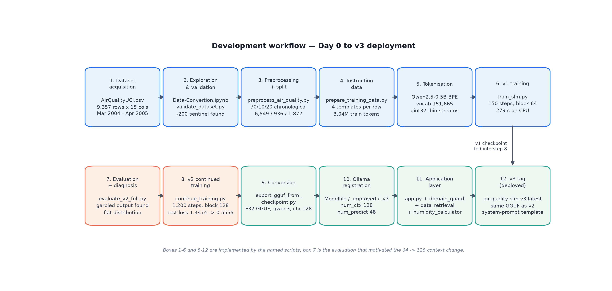

### The narrative in six steps

1. **Acquire and explore (12 Nov).** The UCI CSV is parsed, `-200` sentinels are identified (16,701 cells),
   and the rows are split 70/10/20 **chronologically** — not shuffled — so validation and test are *later*
   hours than training.
2. **Build instruction data (15 Nov).** Each row becomes four sentence pairs. Tokenisation gives 3,041,432
   training tokens.
3. **Train v1 (15 Nov).** 150 steps at `block_size = 64`, 279 seconds on CPU. Loss falls 11.89 → 1.34.
4. **Discover the defect (18 Nov).** Deployed output is garbled. Two causes are measured: flat next-token
   distribution (sampling noise) and **a 64-token context that truncates an 86-token prompt to 34 tokens**.
   The instruction never reached the model. Worse, with `block_size = 64`, no complete instruction/answer
   pair ever fitted a training window: `Response:` was followed by its answer only **≈ 2.6 times in the
   whole run**.
5. **Continue training at 128 tokens (18 Nov).** v2 runs 1,200 steps (0.202 epoch), validation loss
   1.4433 → 0.4896, test loss 1.4474 → 0.5555. Formatting becomes perfect; numbers remain constant.
6. **Deploy and wrap (19–20 Nov).** Export to GGUF, register three tags, build the Python application and a
   proxy so that Ollama Desktop also gets correct numbers and refusals.

---

## 4. Dataset documentation

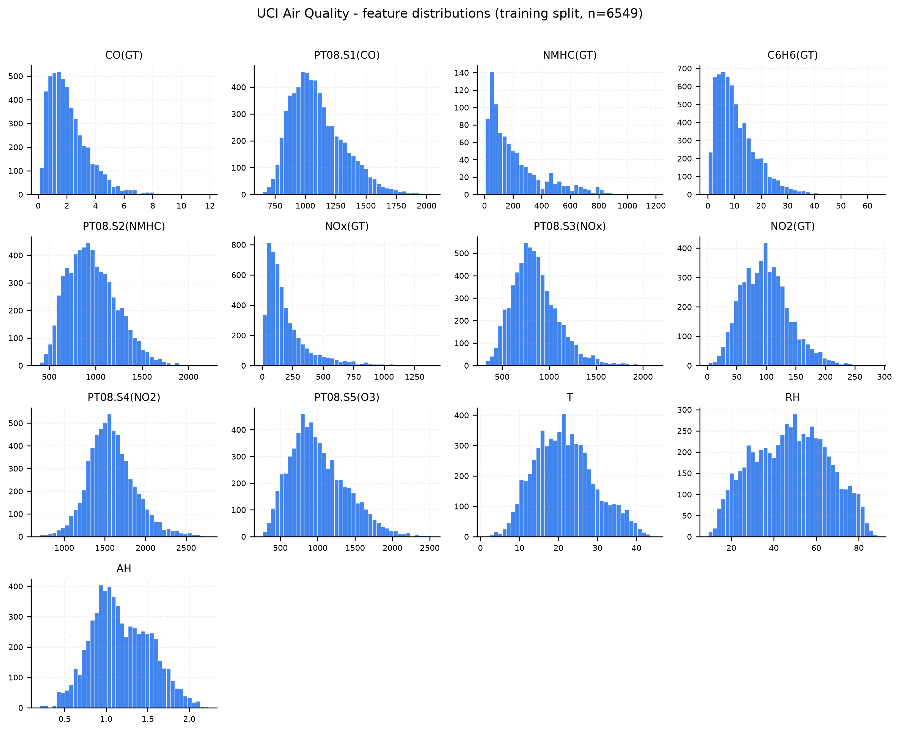

**Source.** UCI Machine Learning Repository, dataset 360, *Air Quality* — S. De Vito et al., 2008,
DOI [10.24432/C59K5F](https://doi.org/10.24432/C59K5F), CC BY 4.0. File: `data/raw/air+quality/AirQualityUCI.csv`.

| Property | Value |
|---|---|
| Data rows | **9,357** (one trailing blank row dropped from the file's 9,358) |
| Columns | 15 (2 time + 13 measurements) |
| Period | 10/03/2004 18:00 → 04/04/2005 14:00 |
| Sampling | hourly averages |
| Unique dates | 391 |
| Duplicate `(Date, Time)` | 0 |
| Missing cells | **16,701** (`-200` sentinel = 12.0 % of measurement cells) |

### Feature table

| Column | Meaning | Unit | Family | Missing |
|---|---|---|---|---|
| `Date` | date | DD/MM/YYYY | time | 0 |
| `Time` | time | HH.MM.SS | time | 0 |
| `CO(GT)` | carbon monoxide | **mg/m³** | ground truth | 1,683 (17.99 %) |
| `PT08.S1(CO)` | tin-oxide sensor | counts | sensor | 366 |
| `NMHC(GT)` | non-methane hydrocarbons | µg/m³ | ground truth | **8,443 (90.23 %)** |
| `C6H6(GT)` | benzene | µg/m³ | ground truth | 366 |
| `PT08.S2(NMHC)` | titania sensor | counts | sensor | 366 |
| `NOx(GT)` | total nitrogen oxides | **ppb** | ground truth | 1,639 (17.52 %) |
| `PT08.S3(NOx)` | tungsten-oxide sensor | counts | sensor | 366 |
| `NO2(GT)` | nitrogen dioxide | µg/m³ | ground truth | 1,642 (17.55 %) |
| `PT08.S4(NO2)` | tungsten-oxide sensor | counts | sensor | 366 |
| `PT08.S5(O3)` | indium-oxide sensor | counts | sensor | 366 |
| `T` | temperature | °C | environment | 366 |
| `RH` | relative humidity | % | environment | 366 |
| `AH` | absolute humidity | g/m³ | **derived** | 366 |

**Ground truth vs sensor vs derived** — a distinction worth stating in any paper:

* `*GT` columns are what a calibrated analyser measured. They are the labels.
* `PT08.*` columns are raw instrument responses. They drift, cross-react, and are *not* concentrations.
* `AH` is computed by the dataset authors from `T` and `RH`; it is a formula output, not an independent
  measurement. That is why the humidity task is really formula reconstruction.

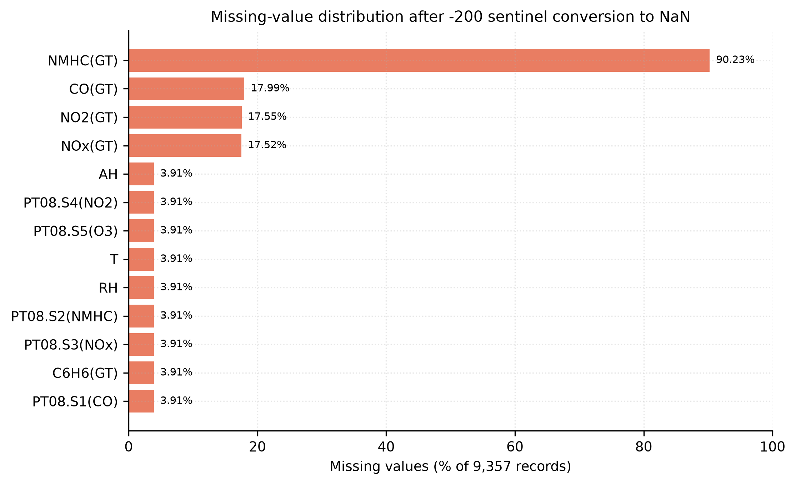

Full detail: [docs/DATASET_GUIDE.md](docs/DATASET_GUIDE.md).

---

## 5. Data preprocessing and preparation

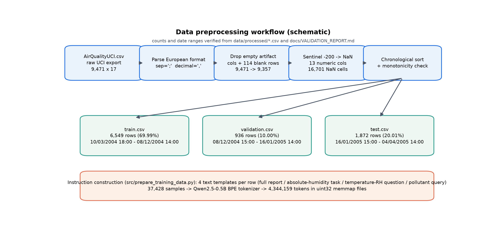

| Step | Operation | Why | Where |
|---|---|---|---|
| 1 | Drop fully empty trailing rows/columns | the CSV carries an artefact row and two empty columns | `src/preprocess_air_quality.py` |
| 2 | Replace `-200` with `NaN` | `-200` is the dataset's sentinel, not a measurement | same |
| 3 | Verify chronological order | a time-series split is only valid if the file is ordered | same |
| 4 | Split 70/10/20 **by position in time** | evaluation must be on *later* hours, never on shuffled neighbours | same |
| 5 | Serialise values verbatim as text | the model should see physical values with units | `src/prepare_training_data.py` |
| 6 | Emit `Unavailable` for missing values | prevents learning to invent numbers | same |
| 7 | Four instruction templates per row | one style per task (report, AH, T/RH, pollutants) | same |
| 8 | Concatenate per split → `uint32` streams | simple, memory-mappable training corpus | same |
| 9 | Tokenise with Qwen2.5 BPE | 151,665-token vocabulary, `pad = eos = <|endoftext|>` | same |

**No scaling, no normalisation, no imputation, no shuffling, no SMOTE, no outlier clipping.** If a paper
claims any of those, it is describing a different pipeline.

| Split | Rows | Texts | Tokens | From | To |
|---|---:|---:|---:|---|---|
| train | 6,549 | 26,196 | 3,041,432 | 10/03/2004 18:00 | 08/12/2004 14:00 |
| validation | 936 | 3,744 | 431,740 | 08/12/2004 15:00 | 16/01/2005 14:00 |
| test | 1,872 | 7,488 | 870,987 | 16/01/2005 15:00 | 04/04/2005 14:00 |

---

## 6. Model architecture

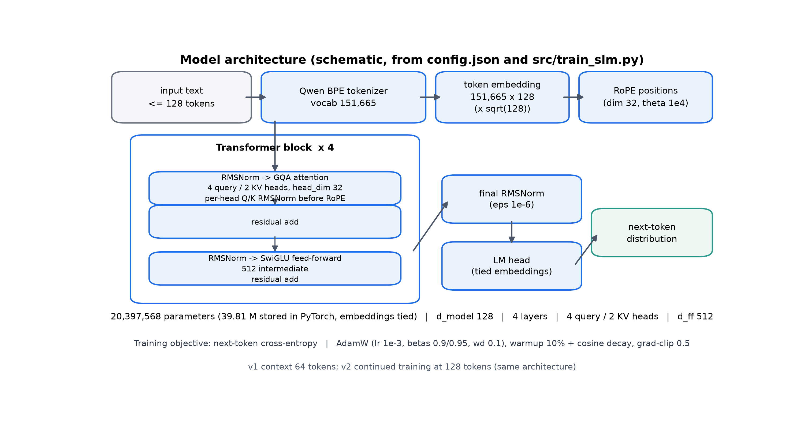

**In beginner terms.** Four identical blocks read the text. Each block first *attends* — it looks back at
earlier words and weights which ones matter — then passes each position through a small two-layer network.
Normalisation before each step keeps the numbers stable, and rotary position embeddings tell the model
where it is in the sentence. A final layer turns the internal state into a probability over the next token.

### Technical specification

| Component | Value |
|---|---|
| Family / HF class | Qwen3-style decoder, `Qwen3ForCausalLM` |
| Parameters (trainable) | **20,397,568** |
| Hidden size `d_model` | 128 |
| Layers | 4 |
| Query heads / KV heads | 4 / 2 (grouped-query attention, 2:1) |
| Head dimension | 32 |
| Feed-forward | SwiGLU, intermediate 512 |
| Normalisation | RMSNorm, ε = 1e-6, pre-norm, plus **Q/K RMSNorm before RoPE** |
| Positional encoding | RoPE, θ = 10,000, rotate-half |
| Context | 64 (v1) → **128** (v2, v3) |
| Vocabulary | 151,665 |
| Tokenizer | `Qwen/Qwen2.5-0.5B` BPE, 151,387 merges, `pad = eos = <|endoftext|>` (151,643), no BOS |
| Embedding tying | yes; input scaled by √128, output head unscaled |
| Precision | float32 |
| Training objective | next-token cross-entropy over concatenated text |

### Where the 20.4M parameters actually are

```
embedding table   151,665 × 128  = 19,413,120   ← 95 % of the model
4 × block:
  attention  q,k,v,o              ≈   131,072
  SwiGLU     gate,up,down  ×512   =   196,608
  norms (4 × 128)                 =       512
final norm                        =       128
```

Only about **1M** parameters do computation; the rest is a 151k-word dictionary. This single fact explains
both the 165 MB file size and the model's limited capacity.

Full detail: [docs/ARCHITECTURE.md](docs/ARCHITECTURE.md).

---

## 7. Model training

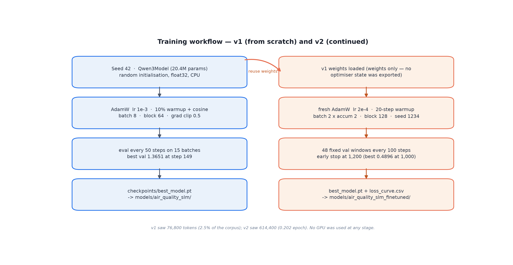

| | v1 | v2 |
|---|---|---|
| Script | `src/train_slm.py` | `src/continue_training.py` |
| Start | random init | v1 weights |
| Steps | 150 | 1,200 (target 2,400, early-stopped) |
| Batch × accum | 8 × 1 | 2 × 2 |
| Block size | 64 | **128** |
| Optimiser | AdamW (0.9, 0.95), wd 0.1, ε 1e-9 | same, fresh state |
| Learning rate | 1e-3 | 2e-4 |
| Schedule | 10 % warmup + cosine → 0.1× | 20-step warmup + cosine → 0.1× |
| Grad clip | 0.5 | 0.5 |
| Seed | 42 | 1234 |
| Device | CPU, float32, 6 threads | same |
| Tokens seen | 76,800 (2.5 % of corpus) | 614,400 (**0.202 epoch**) |
| Runtime | **279.01 s** | **1,864 s** at step 1,200 |
| Checkpoint | `training/checkpoints/best_model.pt` | `models/air_quality_slm_finetuned/best_model.pt` |

### v1 loss trace

| Step | LR | Train | Val | Val PPL |
|---:|---:|---:|---:|---:|
| 0 | 1.0e-4 | 11.8904 | 11.8830 | 144,785 |
| 40 | 9.48e-4 | 5.0992 | 5.1368 | 170.18 |
| 80 | 6.04e-4 | 2.2676 | 2.2905 | 9.88 |
| 120 | 2.13e-4 | 1.5242 | 1.5600 | 4.76 |
| 149 | 1.00e-4 | 1.3390 | 1.3651 | 3.92 |

### v2 loss trace

| Step | Train (EMA) | Val | Val PPL | Epochs |
|---:|---:|---:|---:|---:|
| baseline | — | 1.4433 | 4.235 | — |
| 200 | 0.6425 | 0.6957 | 2.005 | 0.034 |
| 400 | 0.4955 | 0.5559 | 1.744 | 0.067 |
| 600 | 0.4699 | 0.5279 | 1.695 | 0.101 |
| 800 | 0.4470 | 0.5187 | 1.680 | 0.135 |
| **1,000** | 0.4325 | **0.4896** | **1.632** | 0.168 |
| 1,200 | 0.4229 | 0.4905 | 1.633 | 0.202 |

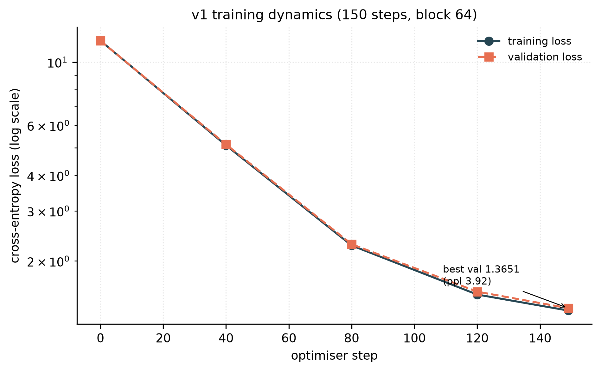

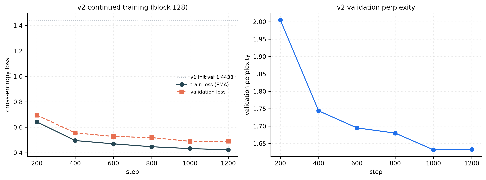

Training stopped on the overfitting signature (validation rising while training fell), not on a fixed step
budget. Full detail: [docs/TRAINING_GUIDE.md](docs/TRAINING_GUIDE.md).

---

## 8. Model version history

| | **v1** | **v2** | **v3** |
|---|---|---|---|
| Ollama tag | `air-quality-slm:latest` | `air-quality-slm-improved:latest` | **`air-quality-slm-v3:latest`** |
| Weights | `air_quality_slm.gguf` | `air_quality_slm_finetuned.gguf` | **the same GGUF as v2** |
| Context | 64 | 128 | 128 |
| `num_predict` | 64 | 48 | 48 |
| Template | `{{ .Prompt }}` | `{{ .Prompt }}` | `{{ .System }}\n{{ .Prompt }}` |
| Digest | `21d7b363c2d4` | `f93c91b218b3` | `1ab6bee975c1` |
| Test loss | 1.4474 | **0.5555** | not measured |
| Test PPL | 4.252 | **1.743** | not measured |
| AH MAE (test) | 9.0992 (corrupted output) | 0.5345 (constant) | not measured |
| Structural correctness | 0 % (ran to cap, repetitive) | **100 %** | inherits v2 |
| Evaluated? | yes | yes | **no** |

### What changed, and why

* **v1 → v2 (weights).** Block size 64 → 128 so an instruction and its answer finally share a window;
  continued training for 1,200 steps. This is the only weight change in the project.
* **v1 → v2 (Modelfile).** `num_ctx` 64 → 128 fixed prompt truncation; `num_predict` 64 → 48 fixed an
  output that cut the RH value.
* **v2 → v3 (Modelfile only).** A template that accepts `{{ .System }}` so the application can prepend
  guidance. **No weights changed. No evaluation was run.**

### Which version is the final deployment target

`air-quality-slm-v3:latest` is the deployed tag — it is the newest interface and the one the system is
built around. **It is not the best-evidenced model.** The best-evidenced model is v2, and v3 *is* v2
numerically. Never write "v3 performs better than v2"; write "v3 adds a system-prompt path that has not
been evaluated".

---

## 9. Model evaluation and performance

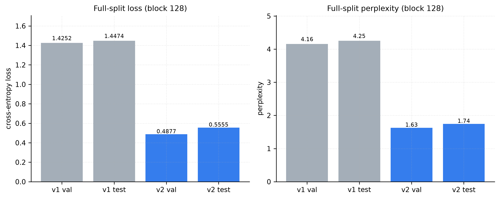

### 9.1 Language modelling

| Model | Split | Tokens scored | Loss | Perplexity |
|---|---|---:|---:|---:|
| v1 | val | 431,488 | 1.4252 | 4.159 |
| v1 | test | 870,784 | 1.4474 | 4.252 |
| **v2** | **val** | 431,488 | **0.4877** | **1.629** |
| **v2** | **test** | 870,784 | **0.5555** | **1.743** |

v2 reduces test loss by **61.6 %** and perplexity from 4.25 to 1.74. Measured on the same harness, same
windows, same token counts.

### 9.2 Numerical accuracy (the important table)

| Quantity | Split | v2 MAE | Constant-predictor MAE | Ratio |
|---|---|---:|---:|---:|
| AH (g/m³) | val | 0.4335 | 0.459 | 0.945 |
| AH (g/m³) | test | 0.5345 | 0.558 | 0.959 |
| T (°C) | val | 11.0262 | 11.491 | 0.960 |
| RH (%) | val | 36.3190 | 15.713 | **2.311** |
| CO (mg/m³) | val | 1.2180 | 1.224 | 0.995 |
| NOx (ppb) | val | 300.8435 | 233.888 | **1.286** |
| NO2 (µg/m³) | val | 35.9242 | 42.188 | 0.852 |
| C₆H₆ (µg/m³) | val | 5.8106 | 5.678 | 1.023 |

`ratio > 1` means **worse than always predicting the training mean**. The reason is in the next row of
evidence: v2's prediction standard deviation is **0.000** for every quantity except AH (0.003). It answers
with one constant per template.

### 9.3 The closed-form comparison that settles the question

The AH prompt contains both `T` and `RH`, and dataset AH is a deterministic function of them:

| Split | n | Closed-form MAE | Model MAE | Model is worse by |
|---|---:|---:|---:|---:|
| val | 804 | 0.02296 | 0.4335 | **18.9×** |
| test | 1,786 | 0.01880 | 0.5345 | **28.4×** |

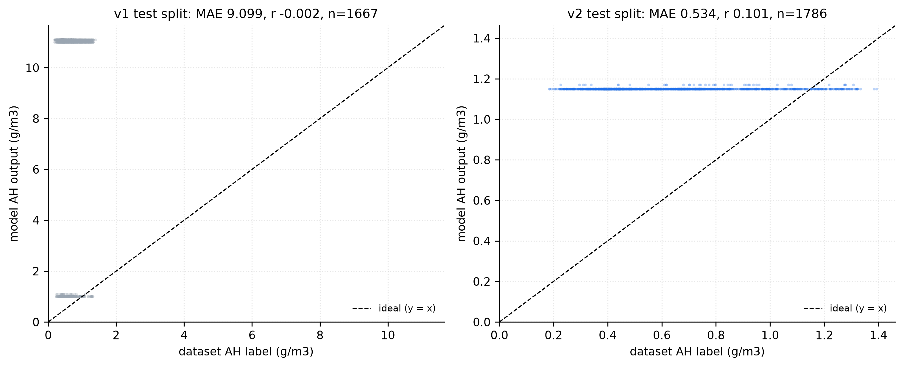

### 9.4 Output structure: perfectly formatted, semantically empty

| Metric | v1 val | v2 val |
|---|---:|---:|
| Emitted EOS | 0.000 | **1.000** |
| Ran to token cap | 1.000 | 0.000 |
| Repetitive text | 0.352 | 0.000 |
| Correct unit | 0.055 | **1.000** |
| Malformed | 1.000 | 0.000 |
| Hallucinated date | 0.000 | **0.333** |
| Distinct outputs (POLLUTANT, 936 prompts) | 3 | **1** |

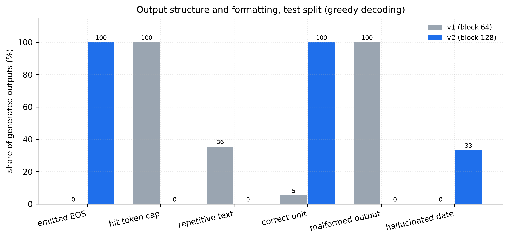

### 9.5 Metrics, defined

| Metric | Formula | Meaning |
|---|---|---|
| Loss | `L = −(1/N) Σ log p(yᵢ \| x<ᵢ)` | average surprise per token (nats) |
| Perplexity | `exp(L)` | effective number of choices |
| MAE | `(1/n) Σ \|ŷ − y\|` | average absolute error in the quantity's units |
| RMSE | `√((1/n) Σ (ŷ − y)²)` | same units, penalises big errors |
| r | `cov(ŷ,y)/(σŷσ_y)` | linear association |
| Ratio | `MAE / constant MAE` | < 1 beats a constant; > 1 loses to one |

**Not measured:** precision, recall, F1 (no classification task), latency benchmarks, human ratings, and any
metric for v3.

Full detail: [docs/EVALUATION_REPORT.md](docs/EVALUATION_REPORT.md).

---

## 10. PyTorch → GGUF conversion

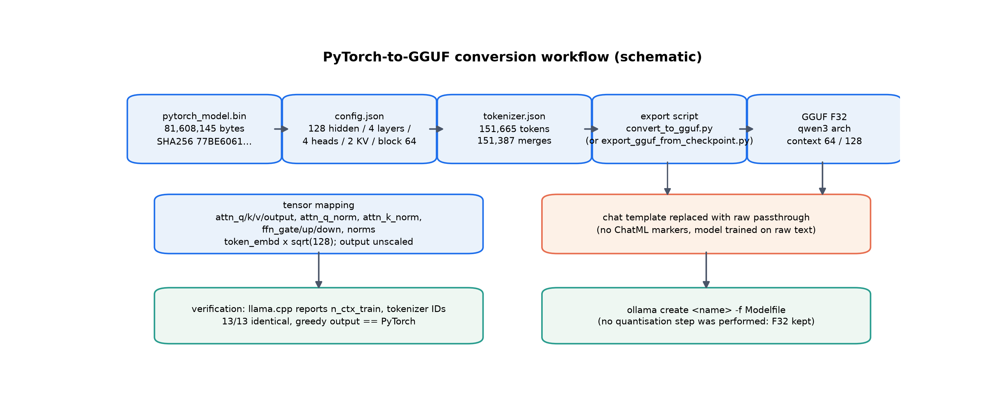

Ollama runs GGUF through llama.cpp; it cannot load a PyTorch `state_dict`. Conversion packages weights,
tokenizer, template and hyper-parameters into one file.

| PyTorch | GGUF | Note |
|---|---|---|
| `tok_emb.weight` | `token_embd.weight` | multiplied by √128 |
| `lm_head.weight` | `output.weight` | tied, written unscaled |
| `blocks.N.attn.{wq,wk,wv,wo}` | `blk.N.attn_{q,k,v,output}` | 4 q heads, 2 kv heads |
| `blocks.N.attn.{q_norm,k_norm}` | `blk.N.attn_{q,k}_norm` | per-head norm, before RoPE |
| `blocks.N.mlp.{w_gate,w_up,w_down}` | `blk.N.ffn_{gate,up,down}` | SwiGLU |

```bash
# v1
./venv/Scripts/python.exe src/convert_to_gguf.py
# v2
./venv/Scripts/python.exe src/export_gguf_from_checkpoint.py \
    --checkpoint models/air_quality_slm_finetuned/pytorch_model.bin \
    --config     models/air_quality_slm_finetuned/config.json \
    --tokenizer  models/air_quality_slm_finetuned \
    --out        models/air_quality_slm_finetuned/air_quality_slm_finetuned.gguf \
    --context    128
```

| Check | Result |
|---|---|
| Tokenizer parity (13 samples, HF vs GGUF) | **13/13 identical** |
| `n_ctx_train` | 64 (v1), 128 (v2) |
| Prompt truncation | `prompt_eval_count` = 86 at ctx 128; **34** at ctx 64 (the v1 bug) |
| Numerical parity | greedy Ollama output token-identical to the PyTorch checkpoint |

**No quantisation exists.** Every GGUF in this project is F32. Full detail:
[docs/CONVERSION_GUIDE.md](docs/CONVERSION_GUIDE.md).

---

## 11. Ollama integration and v3 deployment

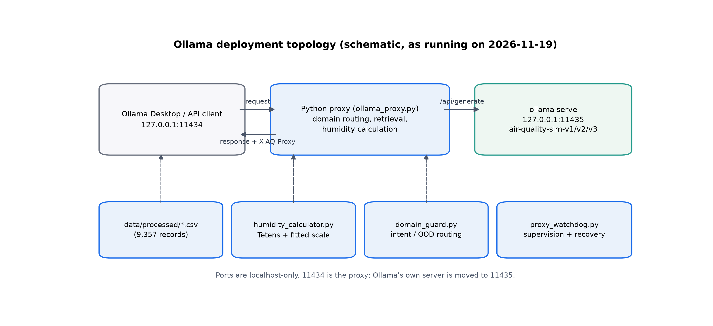

Ollama was chosen because it loads GGUF locally, runs on CPU, needs no account, and lets every generation
parameter be fixed in a text file — which mattered, because this model only behaves under greedy decoding.

### The deployed tag

```bash
ollama create air-quality-slm-v3 -f Modelfile.v3
ollama list                      # with OLLAMA_HOST=http://127.0.0.1:11435
# air-quality-slm-v3:latest   1ab6bee975c1   165 MB
```

`Modelfile.v3` in full:

```
FROM ./models/air_quality_slm_finetuned/air_quality_slm_finetuned.gguf
PARAMETER num_ctx 128
PARAMETER temperature 0
PARAMETER top_k 1
PARAMETER top_p 1.0
PARAMETER min_p 0.0
PARAMETER repeat_penalty 1.0
PARAMETER repeat_last_n 64
PARAMETER num_predict 48
PARAMETER stop "<|endoftext|>"
TEMPLATE "{{ .System }}\n{{ .Prompt }}"
```

Why each value: `num_ctx 128` because the AH prompt is 86 tokens and 64 truncated it; `temperature 0` /
`top_k 1` because the trained distribution is flat (top-1 ≈ 0.18) and sampling produced gibberish;
`repeat_penalty 1.0` because penalising seen tokens distorted the answer; `num_predict 48` because the
TEMP_RH answer is 47 tokens and 40 cut off the humidity value.

### Selecting it in Ollama Desktop

Install Ollama, run `ollama create air-quality-slm-v3 -f Modelfile.v3` from the project root, then choose
**air-quality-slm-v3:latest** in the model selector.

### ⚠️ What a Desktop session actually demonstrates

On this machine `ollama_proxy.py` occupies port 11434 and answers `POST /api/chat` and `POST /api/generate`
**in Python**, forwarding only model-management endpoints. From the real access log:

```
2026-11-20 01:20:08 | chat | intent=greeting       | IN='Hey'                        | OUT='Hello! Welcome to the Air Quality SLM Assistant.'
2026-11-20 01:20:08 | chat | intent=out_of_domain  | IN='When is Diwali in 2004?'     | OUT='Sorry, this question is outside my current capabilities…'
2026-11-20 01:20:09 | chat | intent=ah_calculation | IN='Calculate absolute humidity for T = 16.7 C and RH = 54.7%.' | OUT='Absolute Humidity Calculation'
2026-11-20 01:20:09 | chat | intent=retrieval      | IN='What was the pollution level on 01/07/2010 at 10:00?' | OUT='No data found for 01/07/2010 at 10.00.00.'
```

So a desktop demo shows the **system** (routing + Python numerics), not the neural network's quality. The
network's own behaviour is §9.4. Both are true; quoting one as the other would be false.

**Screenshots.** No screenshot exists in this repository. `docs/assets/screenshots/README.md` states exactly
what to capture and what each capture would demonstrate. Nothing was fabricated to fill the gap.

Full detail: [docs/OLLAMA_DEPLOYMENT.md](docs/OLLAMA_DEPLOYMENT.md).

---

## 12. Functional capabilities

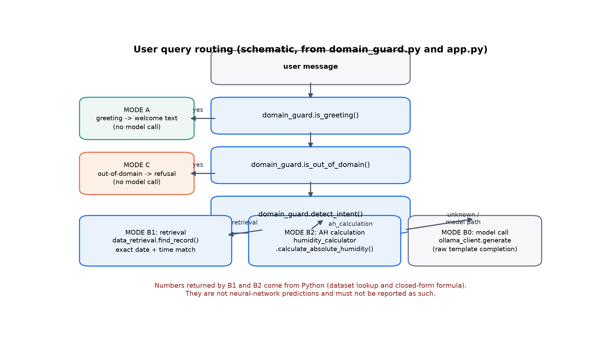

### A. Historical air-quality data retrieval

* **Input:** a date `DD/MM/YYYY` and a time `HH:MM` or `HH.MM.SS` (also `DD-MM-YYYY`, `YYYY-MM-DD`).
* **Process:** exact match on `(Date, Time)` across `train → val → test`; **no interpolation, no nearest
  neighbour**.
* **Returns:** available pollutants with correct units, temperature, RH and AH. Missing cells are omitted.
* **Unavailable record:** a clear "No data found … covers 10 March 2004 – 04 April 2005" message.
* **Verified example** (08/12/2004 15:00): CO 1.2 mg/m³, NOx 179.0 ppb, NO₂ 82.0 µg/m³, C₆H₆ 4.6 µg/m³,
  T 16.7 °C, RH 54.7 %, AH 1.0311 g/m³. NMHC missing.

### B. Absolute-humidity calculation

* **Input:** temperature (°C) and relative humidity (%).
* **Formula:** `e_s = 6.112 · exp(17.67·T / (T + 237.3))` hPa, then
  `AH_phys = 216.7 · (e_s · RH/100) / (T + 273.15)` g/m³, multiplied by a dataset-derived scale.
* **Verified example:** T = 16.7 °C, RH = 54.7 % → **1.0284 g/m³**.
* **Caveat:** the docstring says 243.5 and a 0.976 scale; the code uses 237.3 and a one-row ratio of
  0.12874776. Report 1.0284 as "the value the shipped code returns" — see
  [KNOWN_LIMITATIONS §3](docs/KNOWN_LIMITATIONS.md).

### C. Greeting and capability introduction

`Hey`, `hello`, `what can you do?`, `who are you?` → the welcome block listing both supported tasks with
examples. No model call. Verified in the access log.

### D. Out-of-domain handling

`When is Diwali in 2004?` → a polite refusal naming what the assistant *can* do. Implemented as a keyword
and regex check **before** any model call, because the network was never trained to refuse.

Full detail with copy-paste prompts: [docs/USER_MANUAL.md](docs/USER_MANUAL.md).

---

## 13. Installation and setup manual

For Windows. Commands are the ones actually used in this project.

### 13.1 Requirements

| | Minimum |
|---|---|
| OS | Windows 10/11, macOS or Linux |
| RAM | 8 GB (training used 7.35 GB total) |
| Disk | ~1.5 GB for the project with both GGUFs |
| GPU | **not required** |
| Python | 3.10 – 3.14 (3.14.4 used here) |
| Ollama | 0.30+ (0.33.2 used here) |

### 13.2 Install Python

Download from https://www.python.org/downloads/ and tick **"Add python.exe to PATH"**. Verify:

```bash
python --version
```

### 13.3 Install Ollama

Download from https://ollama.com/download, install, then verify:

```bash
ollama --version
```

### 13.4 Get the project

```bash
git clone https://github.com/sanjanareddy2607-a11y/Air-Quality-SLM
cd Air-Quality-SLM
```

Or unzip a copy of the folder. The dataset is already inside at `data/raw/air+quality/AirQualityUCI.csv`.

### 13.5 Create the environment

```bash
python -m venv venv
./venv/Scripts/python.exe -m pip install -U pip
./venv/Scripts/python.exe -m pip install torch transformers tokenizers numpy pandas gguf tqdm ollama requests matplotlib
```

There is **no `requirements.txt`** in the repository; the versions used are listed in
[§7 of the architecture doc](docs/ARCHITECTURE.md) and in `docs/REPRODUCIBILITY.md`.

### 13.6 Folder structure at a glance

```
Air-Quality-SLM/
├── app.py                 terminal assistant
├── ollama_proxy.py        port-11434 proxy + Python intent handler
├── proxy_watchdog.py      supervisor
├── domain_guard.py        greeting / out-of-domain / intent routing
├── data_retrieval.py      exact dataset lookup
├── humidity_calculator.py Tetens + dataset scale
├── ollama_client.py       Ollama call
├── Modelfile              v1     Modelfile.improved  v2     Modelfile.v3  v3
├── data/                  raw + processed CSVs
├── models/                weights, GGUF, tokenizer, configs
├── training/              checkpoints, token streams, logs
├── src/                   pipeline scripts
├── docs/                  documentation + assets + scripts
└── notebooks/             development notebooks
```

### 13.7 Load the model

```bash
ollama create air-quality-slm-v3 -f Modelfile.v3
OLLAMA_HOST=http://127.0.0.1:11435 ollama list
```

If you also want v1 and v2:

```bash
ollama create air-quality-slm          -f Modelfile
ollama create air-quality-slm-improved -f Modelfile.improved
```

### 13.8 Run it

```bash
# terminal assistant
./venv/Scripts/python.exe app.py

# desktop path (optional): proxy must start first, it takes port 11434
./venv/Scripts/python.exe ollama_proxy.py
```

### 13.9 Test the supported features

```
Hey, what can you do?
What was the NOx concentration on 08/12/2004 at 15:00?
Calculate absolute humidity for T = 16.7 C and RH = 54.7%.
When is Diwali in 2004?
```

### 13.10 Troubleshooting

| Symptom | Cause | Fix |
|---|---|---|
| `ollama list` errors or hangs | port 11434 is the proxy | `OLLAMA_HOST=http://127.0.0.1:11435` |
| `ModuleNotFoundError: domain_guard` | wrong working directory | run from the project root |
| `Error: model not found` | tag not registered | `ollama create ...` from the project root |
| Garbled output | sampling enabled | `temperature 0`, `top_k 1`, `repeat_penalty 1.0` |
| Answer cut before RH value | output cap too small | `num_predict 48` |
| Prompt ignored | context too small | `num_ctx 128` |
| `No data found` | date outside 10/03/2004–04/04/2005 | use a date inside the period |
| Desktop replies instantly | the proxy answered in Python | expected; see §11 |
| `torch` install is huge | CPU wheel not selected | `pip install torch --index-url https://download.pytorch.org/whl/cpu` |

---

## 14. How to use the model

### Example 1 — capability introduction

**You type:** `Hey, what can you do?`
**System does:** `is_greeting()` matches → returns `WELCOME_MESSAGE`. No model call.
**Output (verified):** the welcome block listing historical retrieval and AH calculation, with two example
prompts each.

### Example 2 — historical retrieval

**You type:** `What was the NOx concentration on 08/12/2004 at 15:00?`
**System does:** `detect_intent` → `retrieval`; `_extract_date_time` parses `08/12/2004` and `15:00`;
`find_record()` matches the validation split; `_format_record()` prints the row.
**Output (verified):**

```
Air Quality Data - 08/12/2004 at 15.00.00:

Pollutant concentrations:
  CO: 1.2 mg/m3
  NOx: 179.0 ppb
  NO2: 82.0 ug/m3
  C6H6 (Benzene): 4.6 ug/m3

Temperature: 16.7 C
Relative Humidity: 54.7 %
Absolute Humidity: 1.0311 g/m3
```

### Example 3 — humidity calculation

**You type:** `Calculate absolute humidity for T = 16.7 C and RH = 54.7%.`
**System does:** `_has_ah_keywords` → `ah_calculation`; `parse_ah_request` extracts 16.7 and 54.7;
`calculate_absolute_humidity` computes the result.
**Output (verified):** `Absolute Humidity: 1.0284 g/m3`, with method and note.

### Example 4 — out-of-domain

**You type:** `When is Diwali in 2004?`
**System does:** `is_out_of_domain()` matches the keyword `diwali` → refusal. No model call.
**Output (verified):** `Sorry, this question is outside my current capabilities. I am an experimental Air
Quality SLM designed for historical air-quality measurements and supported humidity calculations…`

### Example 5 — a date outside the dataset

**You type:** `What was the pollution level on 01/07/2010 at 10:00?`
**Output (verified):** `No data found for 01/07/2010 at 10.00.00.` plus the covered period and the expected
format.

> Examples 2, 3, 4 and 5 are verified: they were executed against the code or appear verbatim in
> `proxy_access.log`. Prompts that merely *look* supported (e.g. `How humid was the air at 20 C and 60% RH?`)
> are marked illustrative in [docs/USER_MANUAL.md](docs/USER_MANUAL.md).

---

## 15. Repository structure

| Path | Purpose |
|---|---|
| `app.py` | terminal chat loop, parsing and formatting |
| `domain_guard.py` | greeting / out-of-domain / intent routing (regex + keywords) |
| `data_retrieval.py` | exact `(Date, Time)` lookup in the split CSVs |
| `humidity_calculator.py` | Tetens saturation pressure × dataset scale |
| `ollama_client.py` | thin `ollama.generate()` wrapper, `num_ctx 128`, greedy |
| `ollama_proxy.py` | 11434 → 11435 proxy; answers chat/generate in Python |
| `proxy_watchdog.py` | restart supervisor for proxy and server |
| `Modelfile`, `Modelfile.improved`, `Modelfile.v3` | the three registered parameter sets |
| `data/raw/` | `AirQualityUCI.csv` (+ `.xlsx`), unmodified |
| `data/processed/` | `train.csv`, `validation.csv`, `test.csv` |
| `models/air_quality_slm/` | v1 weights, GGUF, tokenizer, config, training summary |
| `models/air_quality_slm_finetuned/` | v2 weights, GGUF, `best_model.pt`, config |
| `models/air_quality_slm_original/` | backup of the pre-continued-training state |
| `src/` | preprocessing, training, evaluation, conversion, diagnostics |
| `training/` | `checkpoints/`, `data_bin/` token streams, logs |
| `notebooks/` | exploration, v1 training, v2 Colab plan, GPU probe |
| `docs/` | this documentation, `assets/`, `scripts/`, evaluation reports |
| `docs/eval_v2/` | loss JSON, per-row generation dumps, baseline, summary tables |
| `research_package/` | the research evidence package (separate deliverable) |

### GitHub vs Hugging Face

| Artefact | In this repository | Notes |
|---|---|---|
| Source code | yes | |
| Dataset | yes, raw + processed | raw file checksum `13277ae5…` |
| Weights (`.bin`, `.pt`) | yes | ~81 MB each |
| GGUF | yes | 165 MB each |
| Tokenizer | yes | 11.4 MB `tokenizer.json` |
| Modelfiles | yes | three variants |
| Evaluation results | yes, in `docs/eval_v2/` | per-row dumps included |
| Documentation | yes, this file | |
| Screenshots | **no** | none exist |
| Hugging Face mirror | **unverified** | `src/upload_to_huggingface.py` exists; the model card names `sanju7/air-quality-uci`; no upload log was found |

### Reproducing from these files

The full pipeline is four commands (`preprocess` → `prepare_training_data` → `train_slm` →
`continue_training`) plus two conversion commands and one `ollama create`. See
[§13](#13-installation-and-setup-manual) and [docs/REPRODUCIBILITY.md](docs/REPRODUCIBILITY.md).

---

## 16. Limitations and future work

### Measured limitations

| Limitation | Evidence |
|---|---|
| **Constant numerical output** | prediction std 0.000–0.003; 1–5 distinct outputs per 936 prompts |
| **Humidity error 18–28× the closed form** | 0.4335 / 0.5345 vs 0.0230 / 0.0188 g/m³ |
| **Hallucinated timestamps** | 33.3 % of outputs echo `04/04/2004 04.00.00` |
| **Worse than a constant for RH and NOx** | ratio 2.31 and 1.29 |
| **v1 output is corrupted** | repetitive, hits the token cap, unit wrong in 94 % |
| **`num_predict 40` truncated answers** | 0/936 TEMP_RH answers contained an RH value |
| **64-token context truncated prompts** | an 86-token prompt reached the model as 34 tokens |
| **Undertrained** | 0.202 epoch of the corpus |
| **Greedy decoding only** | sampling variance never characterised |

### Structural limitations

* **Historical, not real-time.** The data ends 04/04/2005; there is no sensor, feed or forecast.
* **One city, one roadside site.** No spatial generalisation.
* **Narrow domain.** Air-quality measurements and one formula; nothing else by design.
* **No arithmetic or retrieval inside the network.** Both are Python.
* **Context 128 tokens.** The full-report template (193) does not fit.
* **`NMHC(GT)` unusable on val/test** (100 % missing).
* **No tool integration in Ollama.** The GGUF template has no tool markers and none is configured.
* **The application points at v2** (`MODEL_NAME`), while the v3 tag was designed for system prompts.

### Realistic future work

1. **Reframe as a formatting model.** Let it own language and keep all numbers in Python — which is what
   the application already does — and report task success rather than MAE.
2. **A capacity experiment.** 8 layers at width 256 would test whether arithmetic is learnable at all at
   this scale, cheaply.
3. **A correctness-first benchmark.** Exact-match on the numeric field, with strict parsing.
4. **Fix the three code defects** (unit map, scale factor, `MODEL_NAME`) — no retraining required.
5. **Evaluate v3**, since the system-prompt path has never been measured.
6. **Capture the two demo screenshots** and label them as system behaviour.
7. **Commit everything**: all evaluation artefacts and both documentation packages are currently
   uncommitted.

Full detail: [docs/KNOWN_LIMITATIONS.md](docs/KNOWN_LIMITATIONS.md).

---

## 17. References and acknowledgements

### Dataset

> S. De Vito, E. Massera, M. Piga, L. Martinotto, G. Di Francia, "On field calibration of an electronic nose
> for benzene estimation in an urban pollution monitoring scenario," *Sensors and Actuators B: Chemical*,
> 129(2), 750–757, 2008. doi:10.1016/j.snb.2007.09.060
>
> *Air Quality*, UCI Machine Learning Repository, dataset 360, doi:10.24432/C59K5F, CC BY 4.0.

### Architecture

> A. Yang et al., "Qwen3 Technical Report," arXiv:2505.09388, 2025.
> Qwen Team, "Qwen2.5 Technical Report," arXiv:2412.15115, 2024.
> J. Ainslie et al., "GQA: Training Generalized Multi-Query Transformer Models from Multi-Head
> Checkpoints," arXiv:2305.13245, 2023.
> J. Su et al., "RoFormer: Enhanced Transformer with Rotary Position Embedding," arXiv:2104.09864, 2021.
> N. Shazeer, "GLU Variants Improve Transformer," arXiv:2002.05202, 2020.
> B. Zhang, R. Sennrich, "Root Mean Square Layer Normalization," NeurIPS 2019, arXiv:1910.07467.
> I. Loshchilov, F. Hutter, "Decoupled Weight Decay Regularization," ICLR 2019, arXiv:1711.05101.

### Metrology

> O. A. Alduchov, R. E. Eskridge, "Improved Magnus Form Approximation of Saturation Vapor Pressure,"
> *Journal of Applied Meteorology*, 35(4), 601–609, 1996.

### Software

PyTorch 2.14.1 · transformers 5.23.0 · tokenizers 0.23.3 · gguf 0.19.0 · Ollama 0.33.2 (llama.cpp b12503) ·
pandas 3.1.1 · NumPy 2.5.3 · matplotlib 3.11.2 (figures only).

### Acknowledgements

The dataset authors for publishing a year of co-located reference and sensor measurements; the UCI
repository for hosting it; the Qwen team for an architecture simple enough to re-implement for study.

---

<p align="center"><sub>
Documentation generated from the artefacts in this repository. Every number cites its source file.
Nothing was retrained, no weight was modified, and no experimental value was invented.
</sub></p>
