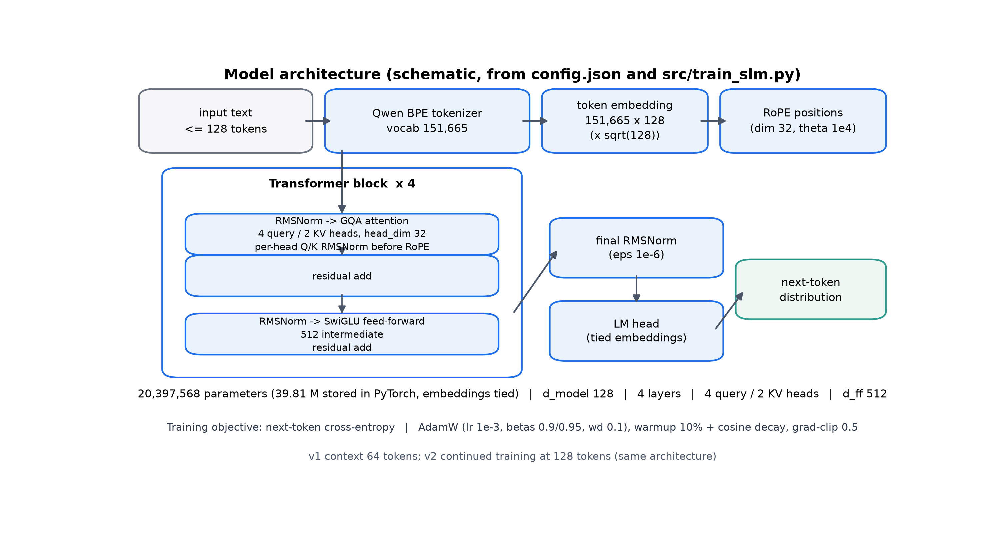
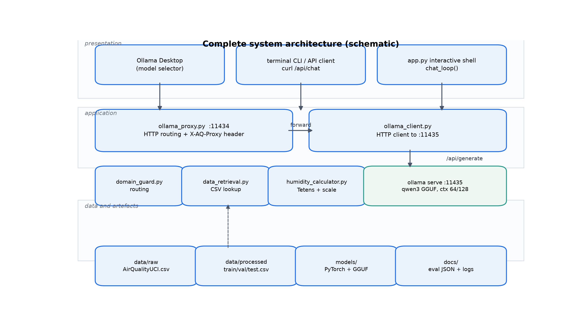

# Architecture



Two architectures are described here, and they are often confused:

1. the **neural network** — 20.4 million parameters, 4 transformer layers, trained from scratch;
2. the **system** — an application that uses Python for every number and the network only for wording.

Keep them separate. Most incorrect claims about this project come from attributing the system's abilities
to the network.

---

## Part 1 — The neural network, in plain language

Imagine a very small language model. It reads a piece of text one token at a time and, at every position,
guesses what token comes next. To make a good guess it must keep some memory of what it has already read.

That memory is built in four repeated blocks. Each block does two things:

* **Attention** — look back at earlier tokens and decide which ones matter for the current position.
  This model uses *grouped-query attention*: four query heads share two key/value heads, which saves
  memory with little quality loss.
* **A feed-forward network** — a small two-layer network applied to each position independently, which
  does most of the actual transformation. This one uses *SwiGLU*, a gated variant.

Before each sub-block the activations are normalised with *RMSNorm*, and positional information is injected
with *rotary position embeddings* (RoPE), which rotate query/key vectors by an angle that depends on
position.

Everything the model knows is in its weights. It has no database, no tools, no memory between calls: one
prompt in, one continuation out.

## Part 2 — The neural network, technically

| Component | Value | Where it is set |
|---|---|---|
| Family / HF class | Qwen3-style decoder, `Qwen3ForCausalLM` | `models/*/config.json` |
| Parameters (trainable) | **20,397,568** | `models/air_quality_slm/training_summary.json` |
| Parameters stored | 39,810,688 (embeddings stored twice, tied at use) | weight file sizes |
| Hidden size `d_model` | 128 | `config.json` |
| Layers | 4 | `config.json` |
| Query heads / KV heads | 4 / 2 (GQA, 2:1) | `config.json` |
| Head dimension | 32 | derived (128 / 4) |
| Feed-forward | SwiGLU, intermediate size 512 | `config.json` |
| Normalisation | RMSNorm, eps 1e-6, pre-norm | `config.json` |
| Attention extras | per-head Q and K RMSNorm applied **before** RoPE | `src/train_slm.py` |
| Positional encoding | RoPE, theta 10,000, rotate-half | `config.json` |
| Context length | 64 (v1) / **128** (v2, v3) | `config.json` |
| Vocabulary | 151,665 | tokenizer |
| Embedding tying | yes (`tie_word_embeddings: true`) | `config.json` |
| Input embedding scale | `tok_emb(x) * sqrt(128)`; output head unscaled | `src/train_slm.py` |
| Precision | float32 | `config.json` (`torch_dtype`) |
| Tokenizer | `Qwen/Qwen2.5-0.5B` BPE, 151,387 merges, `pad = eos = <|endoftext|>` (id 151,643), no BOS | `tokenizer_config.json` |
| Training objective | next-token cross-entropy over the concatenated token stream | `src/train_slm.py` |

### Parameter count, explicitly

```
embeddings      151,665 x 128                 = 19,413,120
per layer       attention  4 x 128 x (32 + 32 + 32)  ... plus output 128 x 128
                SwiGLU     3 x 128 x 512      =   196,608
                norms      4 x 128            =       512
final norm      128                            =       128
```

The 20.4M figure is dominated by the vocabulary: 19.4M of the 20.4M parameters are the embedding table.
Only ~1M parameters do the actual computation. This is why the model can be 165 MB on disk and still run
on a CPU in milliseconds, and also why a 4-layer network at this width has very limited capacity.

### Forward pass

```
tokens ──► token_embd (× sqrt(128)) ──► [ block × 4 ] ──► RMSNorm ──► output head (tied)
                                        │
                                        ├─ RMSNorm ──► Q,K,V (GQA 4:2)
                                        │      Q,K ──► per-head RMSNorm ──► RoPE
                                        │      ──► scaled dot-product attention ──► out proj
                                        └─ RMSNorm ──► SwiGLU FFN (512) ──► residual
```

## Part 3 — The system



```
                    ┌──────────────────────────────────────────┐
  user ──stdin─────►│ app.py  (chat loop, formatting)          │
                    └───────┬──────────────────────────────────┘
                            │
                    ┌───────▼────────────┐   greeting / refusal   ┌─────────────────┐
                    │ domain_guard.py    │───────────────────────►│ static text     │
                    │ regex + keywords   │                        └─────────────────┘
                    └───────┬────────────┘
            retrieval       │        AH calculation      free-form
        ┌───────────────────┴──────────────┐                │
        ▼                                  ▼                ▼
┌──────────────────┐            ┌───────────────────┐  ┌──────────────────┐
│ data_retrieval   │            │ humidity_calculator│  │ ollama_client    │
│ pandas exact     │            │ Tetens + scale     │  │ generate()       │
│ (Date, Time)     │            │                    │  │                  │
└────────┬─────────┘            └────────┬───────────┘  └────────┬─────────┘
         │                               │                       │
         ▼                               ▼                       ▼
  data/processed/*.csv        closed-form arithmetic      ollama_proxy 11434
  (dataset values)            (Python numbers)                    │
                                                                  ▼
                                                        Ollama server 11435
                                                          llama.cpp b12503
                                                          GGUF qwen3 F32
```

| Layer | File | Responsibility | Does it use the neural network? |
|---|---|---|---|
| Interface | `app.py` | Read input, parse dates/times and T/RH, format answers | no |
| Routing | `domain_guard.py` | Greeting, out-of-domain, retrieval, AH, unknown | no |
| Retrieval | `data_retrieval.py` | Exact `(Date, Time)` lookup, correct column → unit | no |
| Calculation | `humidity_calculator.py` | Tetens saturation pressure × dataset scale | no |
| Model client | `ollama_client.py` | Build the request, set `num_ctx`/`num_predict`, greedy decode | **yes** |
| Proxy | `ollama_proxy.py` | Accept 11434, forward to 11435, log | no |
| Supervisor | `proxy_watchdog.py` | Restart proxy/server on failure | no |

### Two-port topology

Ollama Desktop and most clients default to port 11434. In this installation that port is taken by
`ollama_proxy.py`, which forwards to the real server on 11435. Every CLI command in this documentation
therefore sets:

```bash
OLLAMA_HOST=http://127.0.0.1:11435
```

The proxy exists so that the desktop UI, the CLI and the application all reach the same model while traffic
is logged and supervised. It is an operational convenience, not part of the model.

### The division of labour, stated once

> **Python owns every number. The model owns the wording.**

* `data_retrieval.py` returns dataset values → shown as measurements.
* `humidity_calculator.py` returns a formula result → shown as an estimate.
* `ollama_client.generate_response()` returns text → shown as explanation, never as a measurement.

If a sentence in the paper says the model "retrieves", "calculates" or "refuses", it is wrong. Those
behaviours live in `domain_guard.py`, `data_retrieval.py` and `humidity_calculator.py`.

## Part 4 — Design decisions and their reasons

| Decision | Reason | Consequence |
|---|---|---|
| Build a 20M model from scratch instead of fine-tuning a 0.5B base | full control of architecture, and CPU-only training | very limited capacity; mechanical text, constant numbers |
| Serialise numbers as text with units, no scaling | the model sees physical values and can reproduce them in the same form | large token counts per row; vocabulary spread |
| Keep `-200` as `Unavailable` | avoid teaching the model to invent values | very high per-token loss on missing cells |
| Greedy decoding in deployment | the trained distribution is flat (top-1 ≈ 0.18) | output is reproducible but repetitive |
| Context matched to the trained window (64, then 128) | longer prompts were silently truncated | the 86-token AH prompt only fits at 128 |
| Python for all numerics | a 4-layer model cannot do arithmetic reliably | the application is accurate; the model is not |

## Part 5 — What the architecture cannot do

* **No arithmetic.** The network has no mechanism for computation; it reproduces digit patterns.
* **No retrieval.** It cannot look anything up; there is no addressable memory.
* **No tool use.** Ollama's tool API exists, but this project never enabled it, and the GGUF's chat
  template is a raw passthrough with no tool markers.
* **No conversation state.** Each `ollama run` is independent; `app.py` keeps a Python-side history list
  but does not send it to the model.
* **No refusal behaviour.** Refusals are regex branch in `domain_guard.py`, executed before any model call.
