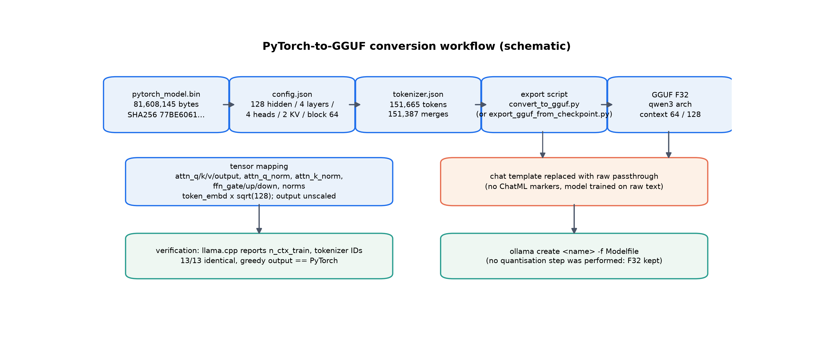

# Conversion Guide — PyTorch to GGUF



How the trained PyTorch checkpoint became an Ollama-runnable file. No quantisation was performed: every
GGUF in this project is **float32**.

---

## 1. Why conversion is needed

The model exists as a `pytorch_model.bin` — a bare dictionary of 47 tensors — plus a custom Python class
in `src/train_slm.py`. Running it requires the right code, the right imports and torch installed.

Ollama does not run PyTorch. It runs **GGUF** files through llama.cpp. A GGUF file is a single
self-describing container:

* the architecture name and structural hyper-parameters,
* the weights,
* the complete tokenizer (vocabulary and merges),
* a chat template,
* the trained context length.

Converting is therefore what turns "a Python program can reconstruct this model" into "any llama.cpp
build can load it".

## 2. Which script for which model

| Script | Produces | Context |
|---|---|---|
| `src/convert_to_gguf.py` | `models/air_quality_slm/air_quality_slm.gguf`, `..._llama_adapted.gguf` | 64 |
| `src/export_gguf_from_checkpoint.py` | `models/air_quality_slm_finetuned/air_quality_slm_finetuned.gguf` | 128 |

`export_gguf_from_checkpoint.py` is the parameterised version and reads the checkpoint's own `config.json`.

## 3. Tensor mapping

The model is not a stock Hugging Face module, so names are translated explicitly.

| PyTorch | GGUF | Transformation |
|---|---|---|
| `tok_emb.weight` | `token_embd.weight` | **× √128** (the model scales embeddings on input) |
| `lm_head.weight` (tied) | `output.weight` | same storage, **unscaled** |
| `norm.weight` | `output_norm.weight` | — |
| `blocks.N.attn_norm.weight` | `blk.N.attn_norm.weight` | — |
| `blocks.N.attn.wq.weight` | `blk.N.attn_q.weight` | — |
| `blocks.N.attn.wk.weight` | `blk.N.attn_k.weight` | 4 query heads, 2 KV heads |
| `blocks.N.attn.wv.weight` | `blk.N.attn_v.weight` | — |
| `blocks.N.attn.wo.weight` | `blk.N.attn_output.weight` | — |
| `blocks.N.attn.q_norm.weight` | `blk.N.attn_q_norm.weight` | per-head Q norm, pre-RoPE |
| `blocks.N.attn.k_norm.weight` | `blk.N.attn_k_norm.weight` | per-head K norm, pre-RoPE |
| `blocks.N.ffn_norm.weight` | `blk.N.ffn_norm.weight` | — |
| `blocks.N.mlp.w_gate.weight` | `blk.N.ffn_gate.weight` | SwiGLU gate |
| `blocks.N.mlp.w_up.weight` | `blk.N.ffn_up.weight` | SwiGLU up |
| `blocks.N.mlp.w_down.weight` | `blk.N.ffn_down.weight` | SwiGLU down |

Scalar metadata written:

```
general.architecture              qwen3
qwen3.block_count                 4
qwen3.embedding_length            128
qwen3.feed_forward_length         512
qwen3.attention.head_count        4
qwen3.attention.head_count_kv     2
qwen3.attention.layer_norm_rms_epsilon  1e-6
qwen3.rope.freq_base              10000.0
qwen3.context_length              64 | 128
```

## 4. Tokenizer preservation

| Item | Value |
|---|---|
| Source file | `tokenizer.json` (11,421,892 B) |
| Vocabulary | 151,665 tokens |
| Merges | 151,387 |
| `tokenizer.ggml.pre` | `qwen2` |
| `eos_token_id` / `pad_token_id` | 151,643 (`<|endoftext|>`) |
| BOS | none |

**Verification performed:** `src/verify_tokenizer.py` encodes 13 sample strings through both the Hugging
Face tokenizer and the GGUF vocabulary and compares the ID sequences. All 13 matched
(`docs/tokenizer_verification.json`).

## 5. The chat template question

Both GGUFs carry a **raw passthrough** template:

```jinja
{{ message['content'] }}
```

not ChatML. The model was trained on raw instruction text with no `<|im_start|>` markers, so injecting
ChatML at inference shows it tokens it never saw in that position — which degrades output. This is also why
the Modelfiles use their own `TEMPLATE` line instead of relying on the tokenizer's template.

`models/air_quality_slm/chat_template.jinja` in the repository is the Qwen ChatML template that ships with
the tokenizer; it is **not** the template used for inference. Do not confuse the two.

## 6. Commands

```bash
# v1
./venv/Scripts/python.exe src/convert_to_gguf.py

# v2 (explicit form)
./venv/Scripts/python.exe src/export_gguf_from_checkpoint.py \
    --checkpoint models/air_quality_slm_finetuned/pytorch_model.bin \
    --config     models/air_quality_slm_finetuned/config.json \
    --tokenizer  models/air_quality_slm_finetuned \
    --out        models/air_quality_slm_finetuned/air_quality_slm_finetuned.gguf \
    --context    128
```

## 7. Artefacts

| File | Size (B) | SHA-256 (prefix) | Context |
|---|---:|---|---:|
| `models/air_quality_slm/air_quality_slm.gguf` | 165,774,560 | `10bb0ead…` | 64 |
| `models/air_quality_slm/air_quality_slm_llama_adapted.gguf` | — | `5ad37e73…` | 64 |
| `models/air_quality_slm_finetuned/air_quality_slm_finetuned.gguf` | 165,774,528 | `ebf9037d…` | 128 |

The v1 and v2 GGUFs differ by 32 bytes. The weights are the same shape and dtype, so the difference is
metadata (context length and template bytes), not parameters.

## 8. Verification after conversion

Four checks were run and recorded:

| Check | Procedure | Result |
|---|---|---|
| Architecture recognised | `ollama show` / `api/ps` | reports `qwen3`, 4 layers, 128 hidden |
| Context honoured | read `n_ctx_train` from llama.cpp | 64 (v1), 128 (v2) |
| No silent truncation | `prompt_eval_count` for an 86-token prompt | 86 at `num_ctx 128`; **34** at `num_ctx 64` (the v1 defect) |
| Numerical parity | greedy output from Ollama vs the PyTorch checkpoint | token-for-token identical |

The truncation check is the important one: at 64 tokens the model never received the instruction, which is
why v1's answers looked like noise rather than like a wrong number.

## 9. Compatibility notes and limitations

* `qwen3` is supported by the llama.cpp build bundled with Ollama 0.33.2 (build `b12503`).
* **No quantised variant exists.** No `Q4_K_M` or similar was produced or benchmarked, so no claim about
  smaller or faster variants is supported.
* The mapping is hand-written. Changing `src/train_slm.py` (adding biases, moving norms) requires a
  matching change in the converter; nothing validates the mapping automatically beyond the parity checks.
* The √d embedding scale is baked into `token_embd`. A consumer that also scales would double-apply it;
  llama.cpp's `qwen3` implementation does not.
* Tied weights are stored once; untie them in training and the converter must be updated.
* Only `qwen3` was ever exercised — the metadata writer is not generic.
