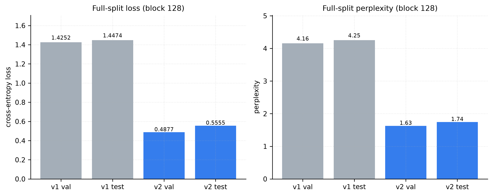
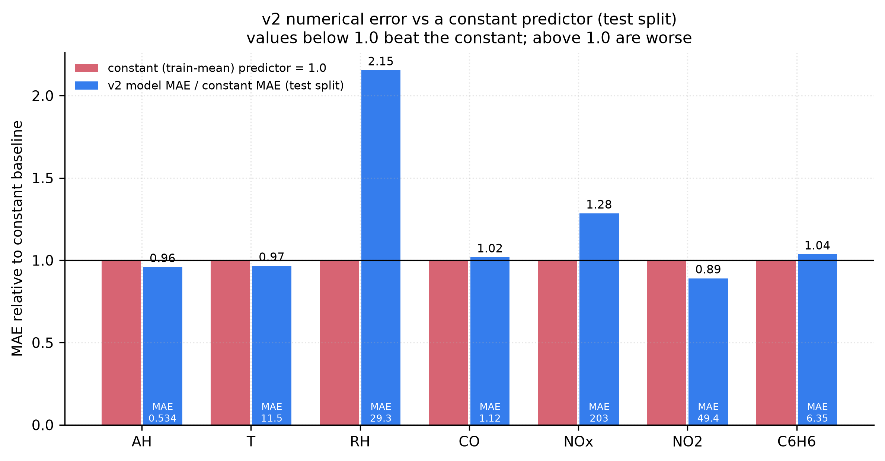
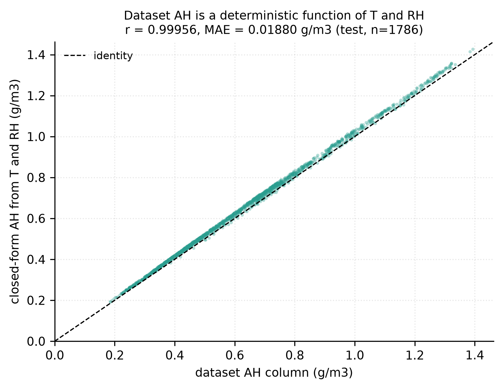
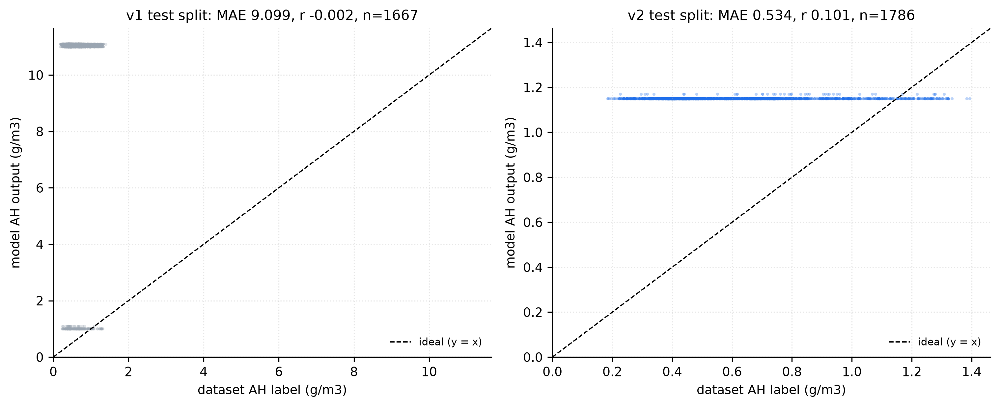
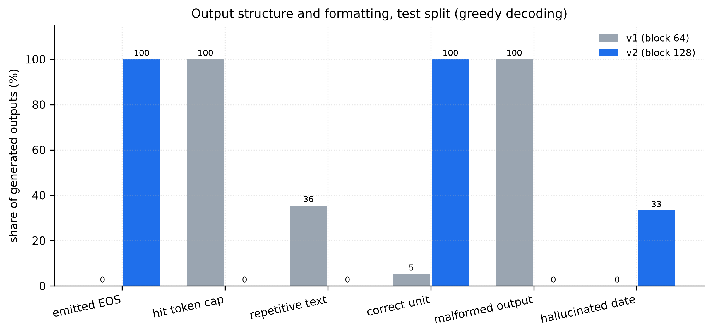

# Evaluation Report

The complete, honest evaluation of v1 and v2. Both checkpoints were scored by the same harness
(`src/evaluate_v2_full.py`), so any difference is a model difference. Every number below is copied from
`docs/eval_v2/*.json` or computed from the per-row dumps; the source file is named for each table.

**v3 does not appear in this report.** It has no evaluation of any kind.

---

## 1. What was measured, and what was not

| Axis | Measured? | Where |
|---|---|---|
| Full-split loss and perplexity | yes | `loss_v1_128.json`, `loss_v2_128.json` |
| Teacher-forced answer loss per template | yes | `summary_tables.txt` |
| Numeric accuracy (MAE, RMSE, correlation) | yes, for AH and five other quantities on v2 | `summary.json`, `metrics_*.json` |
| Output structure (EOS, repetition, units) | yes | `summary_tables.txt` |
| Memorisation / leakage checks | yes | `summary.json` |
| Precision / recall / F1 | **no — never applicable** | the task is generation, not classification |
| Human evaluation of helpfulness | **no** | not performed |
| Latency / throughput benchmark | **no** | only anecdotal run times |
| Quantised-model comparison | **no** | no quantised model exists |
| v3 evaluation | **no** | no metrics file exists |

Do not report precision, recall or F1 for this project. They were never computed and there is no
classification task they could describe.

## 2. Language modelling: loss and perplexity

Every token of each split scored exactly once, over non-overlapping 128-token windows:

| Model | Split | Tokens | Windows | Loss | Perplexity |
|---|---|---:|---:|---:|---:|
| v1 | val | 431,488 | 3,371 | 1.4252 | 4.159 |
| v1 | test | 870,784 | 6,803 | 1.4474 | 4.252 |
| **v2** | **val** | 431,488 | 3,371 | **0.4877** | **1.629** |
| **v2** | **test** | 870,784 | 6,803 | **0.5555** | **1.743** |
| v1 | val@64 | 25,600 | 400 | 1.3583 | 3.890 |
| v1 | test@64 | 25,600 | 400 | 1.4130 | 4.108 |

* Val loss fell **−65.8 %**, test loss **−61.6 %**.
* v1 at its native 64-token window still scores 1.3583 on validation, far worse than v2's 0.4877 — so the
  improvement is not an artefact of the longer context.
* Generalisation gap (test − val): v2 +0.068, v1 +0.022. Larger for v2, as expected for a later period.

**What this means in plain language.** Perplexity is the effective number of equally likely tokens the model
is choosing between. v1 was choosing among ~4.2; v2 among ~1.7. Lower is better, and 1.7 means the model is
very confident about the next token — which, for template text, is largely justified.

**What it does not mean.** A low perplexity on template-shaped text says nothing about numerical correctness.
That is measured separately in §5.



## 3. Teacher-forced answer loss

Loss computed only over the answer tokens, with the prompt given:

| Model | Split | AH | TEMP_RH | POLLUTANT | All | Mean top-1 accuracy |
|---|---|---:|---:|---:|---:|---:|
| v1 | val | 1.4798 | 1.5306 | 1.3656 | 1.4587 | 0.68 |
| v1 | test | 1.4632 | 1.5762 | 1.3453 | 1.4615 | 0.67 |
| **v2** | val | **0.3607** | **0.5947** | **0.4720** | **0.4758** | **0.82** |
| **v2** | test | **0.4086** | **0.7086** | **0.4934** | **0.5369** | **0.81** |

v2's gain is largest where the answer is most templated (AH: one fixed sentence, one number) and smallest on
TEMP_RH (two numbers plus a date). The REPORT template is not scored in this table because it is 193 tokens
and does not fit a 128-token window — an honest gap, not an omission.

## 4. The core finding: v2 answers with a constant

Per quantity, with gold = the dataset's own label. `ratio` = model MAE ÷ constant (train-mean) MAE; **below 1
means it beats predicting the training mean**.

### Absolute humidity

| Model | Split | Extracted | MAE | RMSE | within 5 % | r | pred std | const MAE | ratio | n |
|---|---|---:|---:|---:|---:|---:|---:|---:|---:|---:|
| v1 | val | 94.4 % | 9.3380 | 9.8151 | 1.6 % | −0.038 | 3.009 | 0.459 | 20.36 | 752 |
| **v2** | val | 100 % | **0.4335** | 0.4871 | 1.4 % | 0.006 | 0.003 | 0.459 | 0.945 | 804 |
| v1 | test | 93.6 % | 9.0992 | 9.7186 | 0.7 % | −0.002 | 3.416 | 0.558 | 16.32 | 1,667 |
| **v2** | test | 100 % | **0.5345** | 0.5849 | 3.4 % | 0.101 | 0.003 | 0.558 | 0.959 | 1,786 |

v1's AH outputs are corrupted strings such as `11.0.0.0.0.0.0.0.0.0.0.0.0.04`; a lenient extractor still
credits 94 % of them with a number, which is why v1's MAE is finite (9.34) rather than infinite. v2 always
emits a well-formed number — the *same* one every time.

### All quantities, v2

| Quantity | Split | MAE | RMSE | within 5 % | pred std | const MAE | ratio |
|---|---|---:|---:|---:|---:|---:|---:|
| AH (g/m³) | val | 0.4335 | 0.4871 | 1.4 % | 0.003 | 0.459 | 0.945 |
| AH (g/m³) | test | 0.5345 | 0.5849 | 3.4 % | 0.003 | 0.558 | 0.959 |
| T (°C) | val | 11.0262 | 11.5868 | 0.0 % | 0.000 | 11.491 | 0.960 |
| T (°C) | test | 11.5356 | 12.7249 | 3.1 % | 0.000 | 11.951 | 0.965 |
| RH (%) | val | 36.3190 | 39.4636 | 0.9 % | 0.000 | 15.713 | **2.311** |
| RH (%) | test | 29.3173 | 33.4316 | 1.4 % | 0.000 | 13.608 | **2.154** |
| CO (mg/m³) | val | 1.2180 | 1.6551 | 8.3 % | 0.000 | 1.224 | 0.995 |
| CO (mg/m³) | test | 1.1197 | 1.3933 | 8.1 % | 0.000 | 1.100 | 1.018 |
| NOx (ppb) | val | 300.8435 | 382.9045 | 1.0 % | 0.000 | 233.888 | **1.286** |
| NOx (ppb) | test | 202.5402 | 285.2763 | 2.5 % | 0.000 | 157.689 | **1.284** |
| NO2 (µg/m³) | val | 35.9242 | 45.4307 | 11.4 % | 0.000 | 42.188 | 0.852 |
| NO2 (µg/m³) | test | 49.4129 | 62.9303 | 7.4 % | 0.000 | 55.509 | 0.890 |
| C6H6 (µg/m³) | val | 5.8106 | 6.9737 | 5.0 % | 0.000 | 5.678 | 1.023 |
| C6H6 (µg/m³) | test | 6.3469 | 7.3235 | 3.4 % | 0.000 | 6.128 | 1.036 |

**Read this table carefully.** A standard deviation of 0.000 means every prediction is identical. The MAE is
therefore just the distance from that one constant to the split's distribution. RH and NOx are **worse than a
constant predictor**. The "within 5 %" hits are rows that happen to sit near the constant — not skill.

v1 produced **no extractable prediction at all** for T, RH, CO, NOx, NO2, C6H6.



## 5. The comparison that settles it

The AH prompt contains `T` and `RH`, and the dataset's `AH` is a deterministic function of them. So the
model's error can be compared against a closed-form calculation on exactly the same inputs:

| Split | n | Closed-form MAE | Closed-form RMSE | r | Constant MAE |
|---|---:|---:|---:|---:|---:|
| train | 6,401 | 0.01881 | 0.02327 | 0.99807 | 0.29173 |
| val | 804 | **0.02296** | 0.02388 | **0.99979** | 0.45874 |
| test | 1,786 | **0.01880** | 0.02024 | **0.99956** | 0.55756 |

v2's AH MAE is **18.9× worse (val)** and **28.4× worse (test)** than the formula whose inputs it was
given. This is the strongest single piece of evidence that the remaining error is architectural — a 4-layer,
128-wide model cannot perform the arithmetic — rather than statistical noise.



## 6. Actual vs predicted absolute humidity



One point per validation row. The predictions collapse onto a single horizontal band: that is the constant
output, plotted honestly. The identity line and the closed-form reference are drawn for comparison.

Paired comparison on identical prompts:

| Split | v2 better than v1 | v2 worse | n |
|---|---:|---:|---:|
| val | 679 | 73 | 752 |
| test | 1,458 | 209 | 1,667 |

v2 is better far more often — but "better than a corrupted string" is a low bar.

## 7. Output structure and behaviour

Fraction of generated outputs (2,808 val / 5,616 test):

| Metric | v1 val | v1 test | v2 val | v2 test |
|---|---:|---:|---:|---:|
| Emitted EOS | 0.000 | 0.000 | **1.000** | **1.000** |
| Ran to the token cap | **1.000** | **1.000** | 0.000 | 0.000 |
| Repetitive text | 0.352 | 0.355 | **0.000** | **0.000** |
| No digits at all | 0.019 | 0.021 | 0.000 | 0.000 |
| Correct unit | 0.055 | 0.053 | **1.000** | **1.000** |
| Wrong unit | 0.333 | 0.333 | 0.000 | 0.000 |
| Hallucinated date | 0.000 | 0.000 | **0.333** | **0.333** |
| Malformed | 1.000 | 1.000 | 0.000 | 0.000 |

v2 is structurally perfect and numerically hollow. It ends every sentence, uses the right units, never
repeats — and invents 33.3 % of its timestamps.



### Distinct outputs

| Split / template | Distinct | Modal share | Modal output |
|---|---:|---:|---|
| v2 val AH | 3 | 84.3 % | `The absolute humidity is 1.15 g/m3.` |
| v2 val TEMP_RH | 5 | 83.5 % | `On 04/04/2004 at 04.00.00, the ambient temperature was 21.2 degrees Celsius and the relative humidity was 21.2%.` |
| v2 val POLLUTANT | **1** | **100 %** | `Recorded CO is 2.2 mg/m3, NOx is 111 ppb, and NO2 is 111 ug/m3 with benzene level at 11.2 ug/m3.` |

Two things worth pointing out to an examiner:

* The TEMP_RH sentence reports **the same number (21.2) for temperature and humidity** — a semantic error no
  unit check catches.
* The POLLUTANT sentence is identical for every row. For the example row the true values are CO 1.2, NOx 179,
  NO2 82, C₆H₆ 4.6.

## 8. Memorisation checks

| Check | v1 val | v2 val |
|---|---:|---:|
| Output verbatim equals a training answer | 0.00 % | 33.33 % |
| Output timestamp matches an existing train row | 0 | 936 |
| Dates in output never seen in the dataset | 0 | 0 |

The 33.33 % is exactly the POLLUTANT third, whose single constant sentence also occurs in training. It is
**not** record-level recall: the numbers attached to the matched timestamp are wrong by 23.9 (val) / 24.9
(test) on average, so nothing is being retrieved.

## 9. Two deployment defects found by this evaluation

**9.1 `num_predict 40` truncated the temperature/RH answer**

| Budget | Ran to cap | RH values extracted |
|---|---:|---:|
| 40 tokens | 66.7 % | **0 / 936** |
| 50 tokens | 0.0 % | 936 / 936 |

The answer is 47 tokens; at 40 the sentence was cut before the humidity number. `Modelfile.improved` now
uses `num_predict 48`.

**9.2 Context truncation at 64 tokens**

Ollama's GGUF declared `context_length 64`, so an 86-token prompt was reduced to its last 34 tokens
(`prompt_eval_count = 34` for any prompt ≥ 64). Fixed by exporting v2 with context 128; `api/ps` then reports
128 and `prompt_eval_count` equals the true 86.

## 10. Metrics explained, mathematically

| Metric | Formula | Plain meaning |
|---|---|---|
| Cross-entropy loss | `L = −(1/N) Σ log p(y_i \| x_<i)` | average surprise per token, in nats |
| Perplexity | `PPL = exp(L)` | effective number of equally likely choices |
| MAE | `(1/n) Σ \|ŷ − y\|` | average absolute error, in the quantity's own units |
| RMSE | `√((1/n) Σ (ŷ − y)²)` | same units, penalises large errors more |
| Pearson r | `cov(ŷ, y) / (σ_ŷ σ_y)` | linear association; 0 means no relationship |
| "Within 5 %" | `\|ŷ − y\| ≤ max(0.05, 0.05·\|y\|)` | share of predictions close to the label |
| Constant baseline MAE | `(1/n) Σ \|ȳ_train − y\|` | what you get by always predicting the training mean |
| Ratio | `MAE / constant MAE` | < 1 beats a constant; > 1 is worse than doing nothing |

## 11. Recommended future evaluation (not performed)

1. A **correctness-first** benchmark: exact-match rate on the numeric field, with strict parsing.
2. **Calibration**: does the model's confidence correlate with correctness?
3. **A held-out city/period** — impossible with this dataset, which is why the task should be reframed.
4. **Human rating** of usefulness on a stratified sample.
5. **Latency and memory** measured with a fixed harness, not anecdote.
6. **A v3 evaluation**, since the system-prompt path has never been measured.

## 12. Reproduce

```bash
./venv/Scripts/python.exe -u src/evaluate_v2_full.py --phase baseline
./venv/Scripts/python.exe -u src/evaluate_v2_full.py --phase suite --suite loss    --threads 6
./venv/Scripts/python.exe -u src/evaluate_v2_full.py --phase suite --suite metrics --max-new 50 --threads 6
./venv/Scripts/python.exe -u src/summarize_eval_v2.py
./venv/Scripts/python.exe -u src/diagnose_v2_numbers.py
```

Any MAE above can be recomputed from the per-row dumps without torch; the snippet is in
`REPRODUCIBILITY.md` §5.
