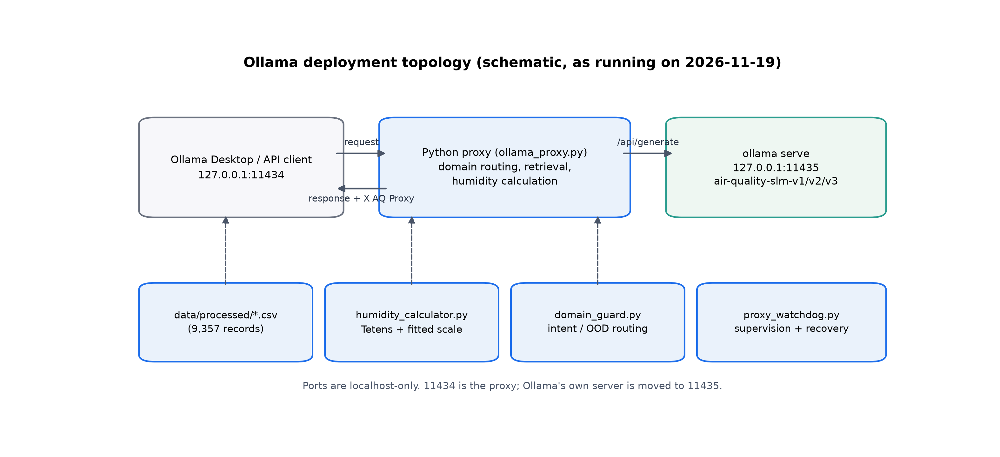

# Ollama Deployment



The deployed model is the tag **`air-quality-slm-v3:latest`**. This document covers what was registered,
what each Modelfile does, how the pieces connect on this machine, and how to install it elsewhere.

---

## 1. What Ollama is, and why it was chosen

Ollama is a local model runner. It loads a GGUF file through llama.cpp, exposes an HTTP API on port 11434,
and provides a desktop chat window. It was chosen because it needs no cloud account, runs on a CPU, and
accepts a plain-text "Modelfile" that fixes generation parameters — which turned out to matter a great deal
for this model (see §4).

## 2. What a Modelfile does

A Modelfile is a build script for a model tag:

| Directive | Effect |
|---|---|
| `FROM` | the GGUF (or another model) to base the tag on |
| `PARAMETER` | default generation settings: context window, sampling, output cap, stop token |
| `TEMPLATE` | how a chat request is rendered into a prompt string |
| `SYSTEM` | a default system instruction (this project injects one from the application instead) |

Registering a Modelfile does **not** copy or modify the GGUF. Ollama records the file reference plus the
parameter/template set, and the tag's digest changes when the Modelfile changes. That is exactly why v2 and
v3 have different digests while sharing byte-identical weights.

## 3. The three registered tags

Verified with `OLLAMA_HOST=http://127.0.0.1:11435 ollama list` on 20 November 2026:

| Tag | GGUF | `num_ctx` | `num_predict` | Template | Digest |
|---|---|---:|---:|---|---|
| `air-quality-slm:latest` | `air_quality_slm.gguf` | 64 | 64 | `{{ .Prompt }}` | `21d7b363c2d4` |
| `air-quality-slm-improved:latest` | `air_quality_slm_finetuned.gguf` | 128 | 48 | `{{ .Prompt }}` | `f93c91b218b3` |
| **`air-quality-slm-v3:latest`** | **same file as v2** | 128 | 48 | `{{ .System }}\n{{ .Prompt }}` | `1ab6bee975c1` |

All three report `165 MB` on disk. Ollama version `0.33.2`, llama.cpp build `b12503`.

### Modelfile (v1)

```
FROM ./models/air_quality_slm/air_quality_slm.gguf
PARAMETER num_ctx 64
PARAMETER temperature 0
PARAMETER top_k 1
PARAMETER top_p 1.0
PARAMETER min_p 0.0
PARAMETER repeat_penalty 1.0
PARAMETER repeat_last_n 64
PARAMETER num_predict 64
PARAMETER stop "<|endoftext|>"
TEMPLATE """{{ .Prompt }}"""
```

The file's own comments record why decoding is greedy: the trained next-token distribution is flat (top-1
probability ≈ 0.18 even on in-distribution prompts), so sampling at temperature 0.7 / top-k 40 selected
low-probability fragments and produced garbled, multilingual text.

### Modelfile.improved (v2)

Same, with `num_ctx 128` and `num_predict 48`. Both changes came from measurement:

* the absolute-humidity prompt is 86 tokens, so under `num_ctx 64` Ollama silently truncated it to its last
  34 tokens — the model never saw the instruction;
* a 40-token output cap cut the temperature/RH answer before the humidity value (0/936 answers contained an
  RH number at 40; 936/936 at 50 — the answer is 47 tokens).

### Modelfile.v3 (v3) — the deployed tag

Identical parameters to v2, with

```
TEMPLATE "{{ .System }}\n{{ .Prompt }}"
```

so the application can prepend a system instruction. The comments in the file record the intended text
(`app.py` is expected to send it):

> "You are the Air Quality SLM Assistant. Provide concise natural-language explanations. Never invent
> numerical values - use Python-authoritative lookups. Return polite out-of-domain refusals for unsupported
> questions. Use deterministic decoding (temp=0, top_k=1)."

**v3 has never been evaluated.** No metrics file, no generation dump, no report. Its weights are byte-identical
to v2. Do not claim v3 is better than v2; it is an interface variant.

## 4. Registration

```bash
cd <project root>          # FROM paths are relative to the working directory
ollama create air-quality-slm          -f Modelfile
ollama create air-quality-slm-improved -f Modelfile.improved
ollama create air-quality-slm-v3       -f Modelfile.v3
```

Registration imports the GGUF and writes a manifest. It takes seconds.

## 5. The two-port topology on this machine

```
Ollama Desktop ─┐
CLI (default) ──┼─► 127.0.0.1:11434  ollama_proxy.py
app.py ─────────┘         │
                          ├─ POST /api/chat     → Python intent handler
                          ├─ POST /api/generate → Python intent handler
                          └─ everything else    → forwarded to 127.0.0.1:11435
                                                        │
                                                   Ollama server (real)
                                                   llama.cpp b12503
```

Consequences you will hit immediately:

```bash
ollama list                                        # fails: 11434 is the proxy
OLLAMA_HOST=http://127.0.0.1:11435 ollama list      # works: real server
```

Process control: `start_ollama_proxy.bat`, `stop_ollama_proxy.bat`, `check_ollama_proxy.bat`,
`proxy_watchdog.py`, `scripts/integration_ctl.py`; procedure in `application/INTEGRATION_OPERATIONS.md`.

## 6. Where the answers actually come from — read this before demonstrating

The proxy does **not** pass chat messages to the neural network. It answers them itself, in Python:

| Intent | Handler | What the user sees |
|---|---|---|
| greeting | `ollama_proxy.WELCOME_MESSAGE` | capability introduction |
| out of domain | `ollama_proxy.OUT_OF_DOMAIN_MESSAGE` | polite refusal |
| retrieval | `data_retrieval.find_record()` + `_format_record()` | dataset values with correct units |
| AH calculation | `humidity_calculator.calculate_absolute_humidity()` | formula result |
| anything else | `UNKNOWN_MESSAGE` | list of supported formats |

The genuine proxy access log (`proxy_access.log`, 20 November 2026) shows this working:

```
2026-11-20 01:14:32 | chat | intent=retrieval      | IN='What was the NOx concentration on 08/12/2004 at 15:00?'  | OUT='Air Quality Data - 08/12/2004 at 15.00.00:'
2026-11-20 01:20:08 | chat | intent=greeting       | IN='Hey'                                                    | OUT='Hello! Welcome to the Air Quality SLM Assistant.'
2026-11-20 01:20:08 | chat | intent=out_of_domain | IN='When is Diwali in 2004?'                                | OUT='Sorry, this question is outside my current capabilities. I am an experimental Ai'
2026-11-20 01:20:09 | chat | intent=ah_calculation | IN='Calculate absolute humidity for T = 16.7 C and RH = 54.7%.' | OUT='Absolute Humidity Calculation'
2026-11-20 01:20:09 | chat | intent=retrieval      | IN='What was the pollution level on 01/07/2010 at 10:00?'    | OUT='No data found for 01/07/2010 at 10.00.00.'
2026-11-20 01:36:20 | chat | intent=unknown        | IN='where are you '                                          | OUT='I'm not sure how to help with that request.'
```

**So:** an Ollama Desktop session on this machine demonstrates the *system* (routing + Python numerics),
not the neural network. The neural network's own behaviour is documented in `EVALUATION_REPORT.md` §7: one
constant sentence per template. Both statements are true; conflating them would misrepresent the project.

Because the raw GGUF is still what `FROM` points at, `ollama run air-quality-slm-v3:latest "<prompt>"`
also goes through port 11434 by default. Setting `OLLAMA_HOST=http://127.0.0.1:11435` bypasses the
interception and shows the model's raw continuation.

## 7. Installing on another computer

1. Install Ollama 0.30+ from https://ollama.com/download; confirm with `ollama --version`.
2. Copy the project, including `models/air_quality_slm/` and `models/air_quality_slm_finetuned/`
   (≈ 500 MB with both GGUFs).
3. `cd` into the project root.
4. `ollama create air-quality-slm-v3 -f Modelfile.v3`
5. In Ollama Desktop, choose **air-quality-slm-v3:latest** in the model selector.
6. Optional: run `python app.py` for the terminal assistant, or `python ollama_proxy.py` to reproduce the
   desktop behaviour (start it before Ollama Desktop, since it takes port 11434).

**No public download exists.** `ollama pull air-quality-slm-v3` will fail — the tag is local. Do not
publish a link claiming otherwise.

## 8. Troubleshooting

| Symptom | Cause | Fix |
|---|---|---|
| `ollama list` hangs or errors | 11434 is the proxy | `OLLAMA_HOST=http://127.0.0.1:11435` |
| `Error: model not found` | tag not registered, or wrong working directory | register from the project root |
| Garbled, multilingual output | sampling instead of greedy | `temperature 0`, `top_k 1`, `repeat_penalty 1.0` |
| Answer stops before the humidity value | output cap too small | `num_predict 48` |
| Prompt seems ignored | `num_ctx 64` truncating an 86-token prompt | `num_ctx 128` with the v2 GGUF |
| Desktop shows a reply instantly with no model load | the proxy answered it in Python | expected; see §6 |
| `failed to load model` | incomplete GGUF copy | re-check SHA-256 against the inventory |
