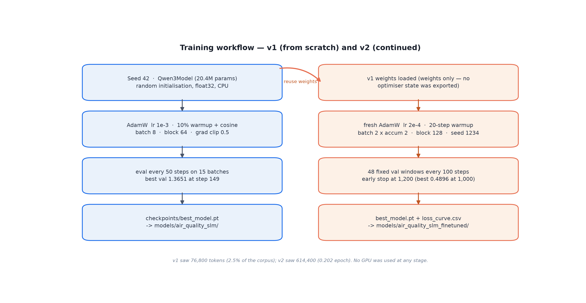
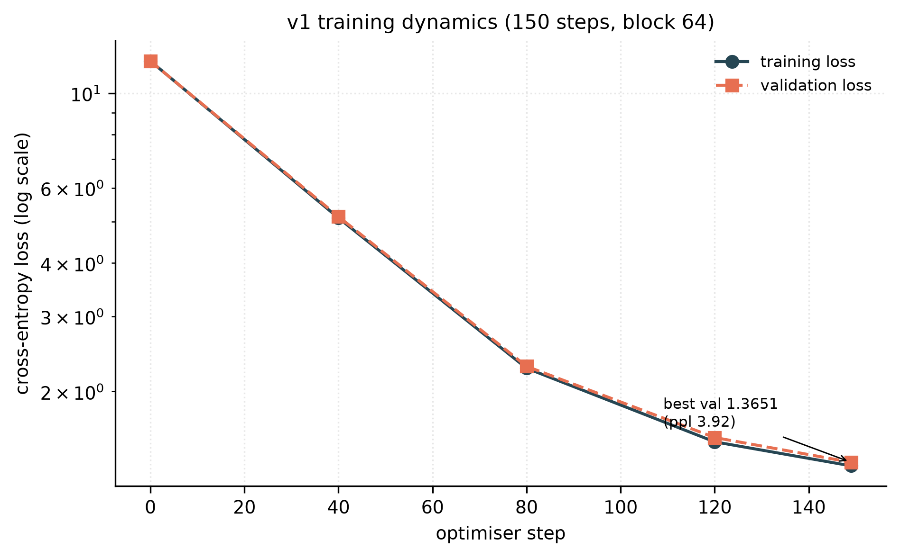
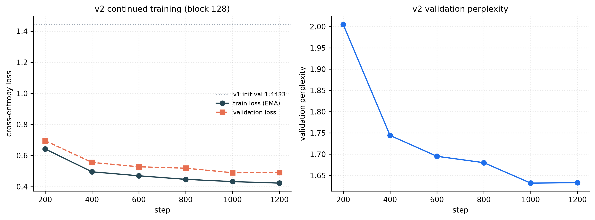

# Training Guide



How the model was actually trained, why there are two runs, and how to repeat them. Every hyper-parameter
below is copied from `training_config.json`, `src/train_slm.py`, `src/continue_training.py` or the
training logs — none is estimated.

---

## 1. The two runs, and why the second exists

| | v1 | v2 |
|---|---|---|
| Script | `src/train_slm.py` | `src/continue_training.py` |
| Starting point | random initialisation | the exported v1 weights |
| Purpose | produce a first model end-to-end | fix the instruction/answer separation defect |
| Steps | 150 | 1,200 (target 2,400, early-stopped) |
| Block size | 64 | **128** |
| Runtime | 279.01 s | 1,864 s at step 1,200 (≈ 31 min) |
| Output | `models/air_quality_slm/` | `models/air_quality_slm_finetuned/` |

**The defect v2 was built to fix.** Each training sample is a complete sentence pair, 83–201 tokens long.
With `block_size = 64`, the model almost never saw the instruction and its answer inside the same window:
the measured exposure to the string `Response:` immediately followed by an answer was **≈ 2.6 times in the
entire v1 run**. The model therefore learned the style of the dataset's prose but not the association
"after `Response:` come the answer digits". That is the mechanism behind v1's garbled, repetitive numbers,
and it was measured before v2 was designed, not assumed afterwards.

## 2. Data fed to the trainer

| Split | Source rows | Texts generated | Tokens |
|---|---:|---:|---:|
| train | 6,549 | 26,196 (4 per row) | 3,041,432 |
| validation | 936 | 3,744 | 431,740 |
| test | 1,872 | 7,488 | 870,987 |

Texts are concatenated into one continuous stream per split and stored as memory-mapped `uint32` arrays in
`training/data_bin/`. The trainer samples fixed-length windows from that stream.

## 3. The four templates (verbatim from `src/prepare_training_data.py`)

**T1 — full report (193 tokens):**

```
Air quality measurement report for {date} at {time}: Carbon Monoxide CO(GT)={co} mg/m3
(sensor PT08.S1={s1}), Non-Methane Hydrocarbons NMHC(GT)={nmhc} ug/m3 (sensor PT08.S2={s2}),
Benzene C6H6(GT)={c6h6} ug/m3, Nitrogen Oxides NOx(GT)={nox} ppb (sensor PT08.S3={s3}),
Nitrogen Dioxide NO2(GT)={no2} ug/m3 (sensor PT08.S4={s4}), Ozone sensor PT08.S5={s5},
Temperature={t} C, Relative Humidity={rh} %, Absolute Humidity={ah} g/m3.
<|endoftext|>
```

**T2 — absolute humidity (100 tokens: 86 prompt + 14 answer):**

```
Task: Predict the absolute humidity given the following parameters: Date: {date}, Time: {time},
CO(GT): {co}, NOx(GT): {nox}, NO2(GT): {no2}, Temperature: {t} C, Relative Humidity: {rh} %.
Response: The absolute humidity is {ah} g/m3.
<|endoftext|>
```

**T3 — temperature and RH (83 tokens: 36 + 47):**

```
Question: What were the ambient temperature and relative humidity recorded on {date} at {time}?
Answer: On {date} at {time}, the ambient temperature was {t} degrees Celsius and the relative
humidity was {rh}%.
<|endoftext|>
```

**T4 — pollutant concentrations (88 tokens: 43 + 45):**

```
Query: What are the primary pollutant concentrations (CO, NOx, NO2) on {date} at {time}?
Result: Recorded CO is {co} mg/m3, NOx is {nox} ppb, and NO2 is {no2} ug/m3 with benzene level
at {c6h6} ug/m3.
<|endoftext|>
```

Missing values become the literal token `Unavailable` (e.g. `NOx(GT): Unavailable`). Nothing is imputed.
Note that **T2's prompt already contains both inputs of the humidity formula** (`T` and `RH`), which is why
the evaluation compares the model against a closed-form calculation on the same inputs.

## 4. v1 hyper-parameters

| Setting | Value |
|---|---|
| Seed | 42 |
| Steps | 150 |
| Batch size | 8, no gradient accumulation (effective 8) |
| Block size | 64 |
| Optimiser | AdamW, lr **1e-3**, betas (0.9, 0.95), weight decay 0.1, eps 1e-9 |
| Schedule | 10 % linear warmup, then cosine decay to 0.1× |
| Gradient clipping | global norm 0.5 |
| Evaluation | every 50 steps, 15 batches |
| Mixed precision | off (float32) |
| Device | CPU |
| Tokens seen | 150 × 8 × 64 = **76,800** = 2.53 % of the corpus |

Batch sampling uses `torch.randint`, i.e. **with replacement**, so v1's exact loss trace is not
bit-reproducible.

## 5. v2 hyper-parameters

| Setting | Value | Reason |
|---|---|---|
| Seed | 1234 | — |
| Steps | 1,200 of a 2,400 target | early stopping, patience 6 evaluations |
| Batch × accumulation | 2 × 2 = 4 effective | 7.35 GiB machine; logits at vocab 151,665 dominate memory |
| Block size | **128** | every template except the 193-token report now fits whole |
| Learning rate | **2e-4** | resuming a model that had already converged |
| Schedule | 20-step warmup + cosine to 0.1× | same shape as v1 |
| Sampler | one shuffled permutation per epoch | systematic coverage instead of sampling with replacement |
| Evaluation | 48 fixed evenly-spaced windows | identical batches for both checkpoints |
| Threads | 6 | half the 12 logical CPUs |
| Tokens seen | 614,400 = **0.202 epoch** | ≈ 8× v1's exposure |
| Checkpoint kept | step 1,000 (val 0.4896) | val rose to 0.4905 at 1,200 while train kept falling |

**Optimiser state was not resumed.** The exported v1 weights were a bare `OrderedDict` with no
optimiser/scheduler state, so v2 started a fresh AdamW. v2 is therefore *continued training*, not a
bit-exact resumption. This is stated here rather than glossed over.

## 6. Loss

Standard next-token cross-entropy over every position in the window:

```
L = -(1/N) · Σ log p(token_i | token_<i)
```

Perplexity is `exp(L)`. Nothing is masked: the model is trained to predict the prompt as well as the
answer, because the stream is plain concatenated text.

### v1 trace (from `models/air_quality_slm/training_summary.json`)

| Step | LR | Train loss | Val loss | Val PPL |
|---:|---:|---:|---:|---:|
| 0 | 1.0e-4 | 11.8904 | 11.8830 | 144,785 |
| 40 | 9.48e-4 | 5.0992 | 5.1368 | 170.18 |
| 80 | 6.04e-4 | 2.2676 | 2.2905 | 9.88 |
| 120 | 2.13e-4 | 1.5242 | 1.5600 | 4.76 |
| 149 | 1.00e-4 | **1.3390** | **1.3651** | **3.92** |

Test loss 1.4295, test perplexity 4.18.

### v2 trace (from `training/loss_curve.csv`)

| Step | Train loss (EMA) | Val loss | Val PPL | Tokens | Epochs |
|---:|---:|---:|---:|---:|---:|
| baseline | — | 1.4433 | 4.235 | 0 | — |
| 200 | 0.6425 | 0.6957 | 2.005 | 102,400 | 0.034 |
| 400 | 0.4955 | 0.5559 | 1.744 | 204,800 | 0.067 |
| 600 | 0.4699 | 0.5279 | 1.695 | 307,200 | 0.101 |
| 800 | 0.4470 | 0.5187 | 1.680 | 409,600 | 0.135 |
| **1,000** | 0.4325 | **0.4896** | **1.632** | 512,000 | 0.168 |
| 1,200 | 0.4229 | 0.4905 | 1.633 | 614,400 | 0.202 |

Validation loss fell 66 % (1.4433 → 0.4896). Training stopped on the overfitting signature — validation
rising while training loss kept falling — not on a fixed step count.





## 7. What the training data taught, and what it did not

| Learned well | Not learned |
|---|---|
| Sentence openings, units, punctuation, EOS placement | the association between a prompt's numbers and the answer's number |
| The vocabulary of air-quality reports | arithmetic of any kind |
| That responses end after one sentence | how to vary a number with its inputs |

The consequence is measured in `EVALUATION_REPORT.md`: v2 emits **1–5 distinct outputs per 936–1,872
prompts** and its absolute-humidity predictions have a standard deviation of 0.003 g/m³. It is a
formatter, not an estimator.

## 8. Reproduce

```bash
# 1. dataset -> instruction texts -> token streams
./venv/Scripts/python.exe src/preprocess_air_quality.py
./venv/Scripts/python.exe src/prepare_training_data.py

# 2. v1
./venv/Scripts/python.exe src/train_slm.py

# 3. v2 (reads models/air_quality_slm/pytorch_model.bin)
./venv/Scripts/python.exe src/continue_training.py
```

Expect ≈ 5 minutes for v1 and ≈ 31 minutes for v2 on this hardware (Ryzen 5 5600H, 6 threads, CPU only).
A different torch build will shift the last digits; the reported effects (66 % loss reduction, constant
outputs) are far larger than that variation.

## 9. Checkpoints in this project

| File | Size | Note |
|---|---:|---|
| `training/checkpoints/best_model.pt` | 81,608,245 B | v1's best validation checkpoint |
| `training/checkpoints/latest_model.pt` | 244,826,949 B | includes optimiser state, hence the larger size |
| `models/air_quality_slm/pytorch_model.bin` | 81,608,145 B | exported v1 weights (no optimiser state) |
| `models/air_quality_slm_finetuned/pytorch_model.bin` | 81,608,145 B | exported v2 weights |
| `models/air_quality_slm_finetuned/best_model.pt` | 81,608,565 B | v2's best checkpoint copy |

None of these was modified during this documentation work.
