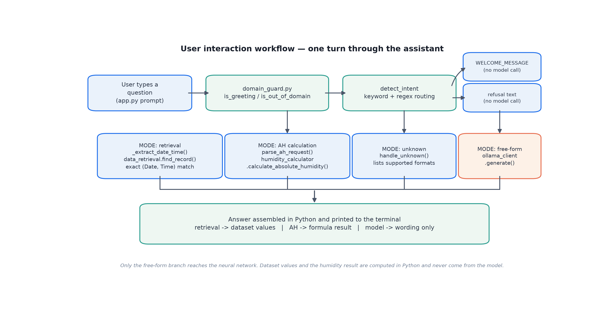

# User Manual

For someone who has never used this project. Two ways to talk to it:

1. **Ollama Desktop** — pick `air-quality-slm-v3:latest` and type into the chat box (with `ollama_proxy.py`
   running, the answers are the system's, not the network's — see `OLLAMA_DEPLOYMENT.md` §6).
2. **Terminal** — `./venv/Scripts/python.exe app.py`.



---

## 1. What it can and cannot do

| Can | Cannot |
|---|---|
| Look up a measurement that exists in the 2004–2005 dataset by date and time | Report live or current air quality |
| Estimate absolute humidity from a temperature and a relative humidity | Explain health effects, policy, or weather forecasts |
| Tell you what it can do, and decline politely when asked something else | Do general knowledge (capitals, festivals, sports) |
| | Answer about dates outside 10/03/2004 – 04/04/2005 |
| | Compute anything beyond the humidity formula |

## 2. Three ways to ask for data

All three are recognised; the first is the canonical form.

```
What was the NOx concentration on 08/12/2004 at 15:00?
Show me the CO, NOx and NO2 values on 08/12/2004 at 15:00.
How was the air quality on 12/03/2004 at 08.00.00?
```

**Date format:** `DD/MM/YYYY` (also accepted: `DD-MM-YYYY`, `YYYY-MM-DD`, `MM/DD/YYYY`).
**Time format:** `HH.MM.SS` in the dataset; the parser also accepts `HH:MM` and `HH:MM:SS`.

### What a successful lookup returns — verified

Prompt: `What was the NOx concentration on 08/12/2004 at 15:00?`

```
Air Quality Data - 08/12/2004 at 15.00.00:

Pollutant concentrations:
  CO: 1.2 mg/m3
  NOx: 179.0 ppb
  NO2: 82.0 ug/m3
  C6H6 (Benzene): 4.6 ug/m3

Temperature: 16.7 C
Relative Humidity: 54.7 %
Absolute Humidity: 1.0311 g/m3
```

*Verified by executing `data_retrieval.find_record('08/12/2004','15:00','val')` and the proxy's own
`_format_record()` on 20 November 2026.* `NMHC` is absent because it is missing for that hour — the system
omits missing values instead of printing `nan`.

### When the date is not in the dataset — verified

Prompt: `What was the pollution level on 01/07/2010 at 10:00?`

```
No data found for 01/07/2010 at 10.00.00.
This date and time is not available in the UCI Air Quality dataset (which covers
10 March 2004 - 04 April 2005).
Please check the date/time format: DD/MM/YYYY at HH:MM.
```

Recorded in `proxy_access.log` at 2026-11-20 01:20:09.

## 3. Asking for an absolute-humidity calculation

```
Calculate absolute humidity for T = 16.7 C and RH = 54.7%.
How humid was the air at 20 C and 60% RH?
T=16.7, RH=54.7
```

### What it returns — verified

Prompt: `Calculate absolute humidity for T = 16.7 C and RH = 54.7%.`

```
Absolute Humidity Calculation
  Temperature:       16.7 C
  Relative Humidity: 54.7 %
  Absolute Humidity: 1.0284 g/m3
  Method: Dataset-calibrated absolute humidity
  Note: This is a dataset-calibrated estimate using the project's Tetens+scale formula,
        fitted on the training split only.
```

*Verified by executing `humidity_calculator.calculate_absolute_humidity(16.7, 54.7)`.*

**Read the caveat.** The same hour in the dataset reports `AH = 1.0311 g/m³`, and the pure physical
calculation gives ≈ 7.99 g/m³. The shipped code uses a scale factor measured from a single training row
(0.12874776) rather than the 0.976 stated in its own docstring. The number 1.0284 is what the software
returns; it is consistent with the dataset to about 0.3 % but for a different reason than the documentation
claims. This is documented as a defect in `KNOWN_LIMITATIONS.md` §3 — quote 1.0284 as "the value returned by
the shipped code", not as a validated physics result.

If you omit a value, it asks:

```
Please provide the temperature and relative humidity so I can calculate absolute humidity.

For example:
  Calculate absolute humidity for T = 16.7 C and RH = 54.7%.
```

## 4. Greeting and capability introduction

Prompt: `Hey, what can you do?`

```
Hello! Welcome to the Air Quality SLM Assistant.

I am an experimental, domain-specific Small Language Model developed using the UCI Air Quality dataset.

I can help you with two main tasks:

1. HISTORICAL AIR QUALITY DATA RETRIEVAL
   I can retrieve available measurements such as CO, NOx, NO2, benzene, temperature,
   relative humidity and absolute humidity using the date and time.

   Example:
     What was the NOx concentration on 08/12/2004 at 15:00?
     Show me CO, NOx and NO2 on 08/12/2004 at 15:00.

2. ABSOLUTE HUMIDITY CALCULATION
   I can estimate absolute humidity from temperature and relative humidity using the
   project's dataset-calibrated calculation method.

   Example:
     Calculate absolute humidity for T = 16.7 C and RH = 54.7%.
     How humid was the air at 20 C and 60% RH?

Please provide your question in one of these formats.

I work with a specific historical dataset and supported calculations. I do not provide
real-time monitoring or general-purpose knowledge.
```

The text is `ollama_proxy.WELCOME_MESSAGE` (verbatim). `app.py` prints a slightly different welcome block
at start-up. Verified in `proxy_access.log`: `intent=greeting | IN='Hey'`.

## 5. Out-of-domain questions

Prompt: `When is Diwali in 2004?`

```
Sorry, this question is outside my current capabilities. I am an experimental Air Quality SLM
designed for historical air-quality measurements and supported humidity calculations.
Please ask me about pollutant concentrations, sensor readings, temperature or humidity instead.
```

Verified in `proxy_access.log`: `intent=out_of_domain | IN='When is Diwali in 2004?'`.

This refusal comes from `domain_guard.is_out_of_domain()` plus a fixed message — **before any model call**.
The neural network has no refusal training; if you bypass the proxy with
`OLLAMA_HOST=http://127.0.0.1:11435 ollama run air-quality-slm-v3:latest "When is Diwali in 2004?"`, you get
raw text continuation, not this message.

## 6. Unrecognised input

Prompt: `go` or `where are you`

```
I'm not sure how to help with that request.

I support two types of questions:
1. Historical data: What was the NOx concentration on 08/12/2004 at 15:00?
2. Humidity calculation: Calculate absolute humidity for T = 20 C and RH = 60%.
```

## 7. Terminal assistant commands

| Input | Effect |
|---|---|
| `help` or `?` | prints the supported formats |
| `reset`, `start over`, `begin again` | clears the conversation and reprints the welcome text |
| `Ctrl+C` | exits |

The terminal prints `(Ollama available)` or `! Ollama not available - ...`; either way the lookups and the
humidity calculation work, because both are pure Python.

## 8. Examples: verified vs illustrative

| Example | Status |
|---|---|
| `What was the NOx concentration on 08/12/2004 at 15:00?` | **verified** — real dataset row, executed |
| `Calculate absolute humidity for T = 16.7 C and RH = 54.7%.` | **verified** — executed, returns 1.0284 |
| `What was the pollution level on 01/07/2010 at 10:00?` | **verified** — "No data found" |
| `Hey, what can you do?` | **verified** — greeting intent logged |
| `When is Diwali in 2004?` | **verified** — refusal intent logged |
| `How humid was the air at 20 C and 60% RH?` | illustrative: matches the parser's supported pattern but its exact output was not captured |
| `Show me CO, NOx and NO2 on 08/12/2004 at 15:00.` | **verified** — retrieval intent logged with this prompt |

## 9. Reading the units correctly

| Column in the dataset | Correct unit | What `app.py` prints |
|---|---|---|
| `CO(GT)` | mg/m³ | `ug/m3` ← **wrong** |
| `NOx(GT)` | ppb | `ug/m3` ← **wrong** |
| `NO2(GT)`, `C6H6(GT)`, `NMHC(GT)` | µg/m³ | `ug/m3` ✓ |

The **Ollama Desktop path (proxy)** prints the correct units, as shown in §2. The **terminal path
(`app.py`)** mislabels CO and NOx. Report values with the correct unit; see `KNOWN_LIMITATIONS.md` §4.

## 10. If something goes wrong

| Problem | Fix |
|---|---|
| `ollama list` errors | the proxy holds 11434; use `OLLAMA_HOST=http://127.0.0.1:11435` |
| Desktop replies with no model loading | the proxy answered in Python — expected |
| Raw garbled text instead of an answer | you bypassed the proxy and hit the network; see `EVALUATION_REPORT.md` §7 |
| `ModuleNotFoundError: domain_guard` | run `app.py` from the project root |
| Humidity answer differs from a physics calculator | expected; see §3 |
